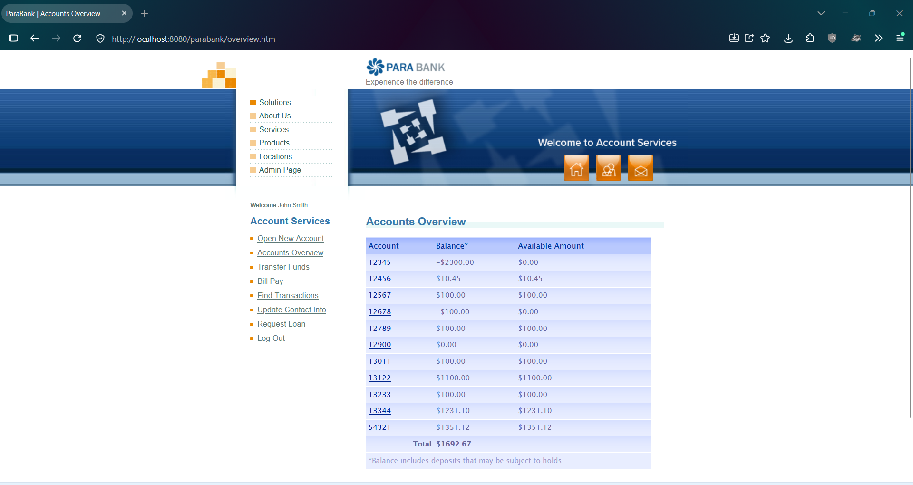
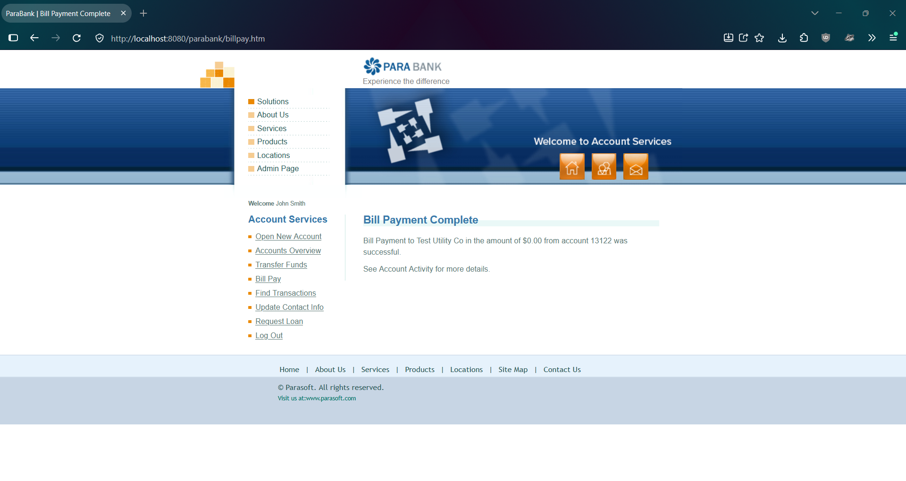
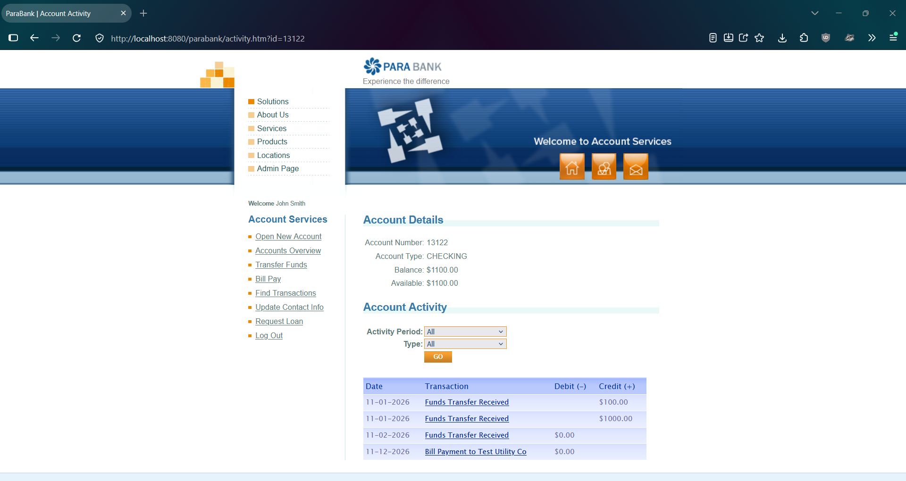
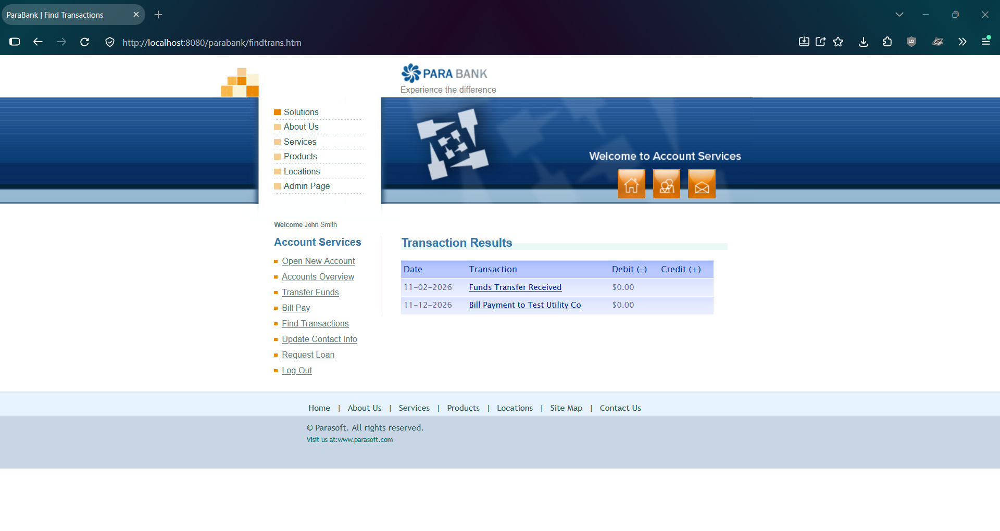

# PBQ-10: Bill Pay accepts a zero-amount payment and records it in the account history

| Field | Value |
|---|---|
| Status | Open |
| Severity | Minor |
| Priority | Low |
| Feature | F-06 Bill Pay |
| Related test case | TC-F06-05 |
| Related defect | PBQ-7 (same behavior in Transfer Funds) |
| Environment | ParaBank (parasoft/parabank, master) run locally on Windows 11, Java 21, default Admin settings, baseline data, user john |
| Reproduced | Acceptance: 2 of 2 attempts. History entry: observed in 1 run. |

## Steps to reproduce
1. Restart ParaBank to the baseline and log in as john / demo.
2. Open Accounts Overview. Note account 13122 = 1100.00 and total = 1692.67.
3. Click Bill Pay.
4. Enter the payee details (Payee Name: Test Utility Co; Address: 1 Test St; City: Testville; State: CA; Zip Code: 90210; Phone #: 555-0100; Account # and Verify Account #: 888888).
5. Enter 0.00 as the amount and select From account 13122.
6. Submit the payment.
7. Open Accounts Overview, then open the Account Activity of account 13122, and search Find Transactions by amount 0.00.

## Expected result
The payment is rejected with a clear message, or at least no transaction is recorded (assumption: a payment of nothing has no meaning; ParaBank has no requirements document and the intended rule is unknown).

## Actual result
The page shows "Bill Payment to Test Utility Co in the amount of $0.00 from account 13122 was successful." Balances are unchanged (13122 = 1100.00, total = 1692.67). Account 13122 shows a new transaction "Bill Payment to Test Utility Co", Debit, $0.00, and Find Transactions by amount 0.00 returns the same entry.

## Impact
A meaningless transaction is added to the account history, which clutters the audit trail and can mislead a customer or an auditor. No money is lost, so severity is Minor. Bill Pay does validate empty and non-numeric amounts correctly (see TC-F06-08 and TC-F06-09), so a zero amount is a gap in otherwise working validation.

## Evidence
Before the payment:

Page after submitting the payment:

Accounts Overview after the payment:

Account Activity for 13122:

Find Transactions by amount 0.00:

