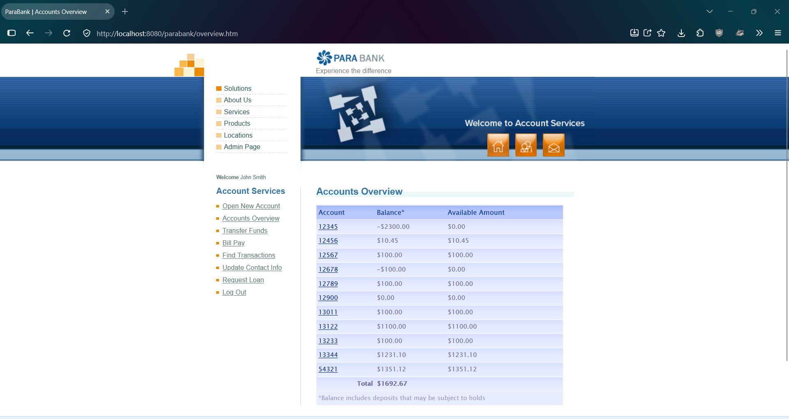
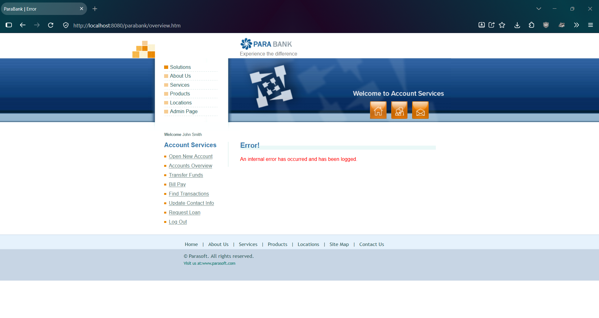
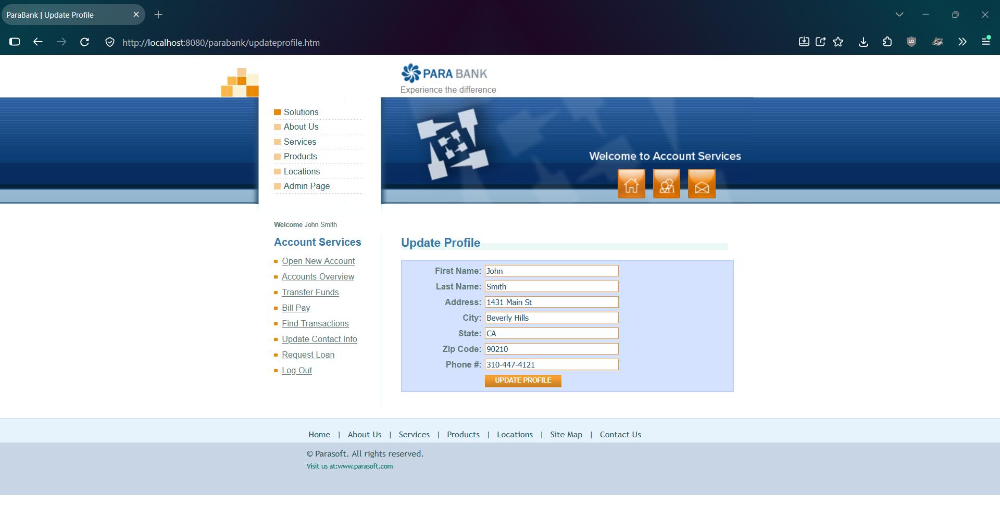

# PBQ-11: Bill Pay accepts an amount with more than two decimal places, then most of the site shows an internal error until ParaBank is restarted

| Field | Value |
|---|---|
| Status | Open |
| Severity | Critical |
| Priority | High |
| Feature | F-06 Bill Pay |
| Related test case | TC-F06-11 |
| Related leads and defect | EO-03, R-04, PBQ-5 (same failure triggered from Transfer Funds) |
| Environment | ParaBank (parasoft/parabank, master) run locally on Windows 11, Java 21, default Admin settings, baseline data, user john |
| Reproduced | 2 of 2 attempts |

## Steps to reproduce
1. Restart ParaBank to the baseline and log in as john / demo.
2. Open Accounts Overview. Note account 13122 = 1100.00 and total = 1692.67.
3. Click Bill Pay.
4. Enter the payee details (Payee Name: Test Utility Co; Address: 1 Test St; City: Testville; State: CA; Zip Code: 90210; Phone #: 555-0100; Account # and Verify Account #: 888888).
5. Enter 10.001 as the amount and select From account 13122.
6. Submit the payment.
7. Click Accounts Overview, then Find Transactions, then the other menu items.

## Expected result
A clear validation message is shown (or the amount is handled consistently), balances stay correct, and the rest of the site keeps working (assumption: invalid input should not break the site; ParaBank has no requirements document).

## Actual result
- The confirmation says "Bill Payment to Test Utility Co in the amount of $10.00 from account 13122 was successful." for an entered amount of 10.001.
- After that, Accounts Overview, Find Transactions, Transfer Funds, Bill Pay, and Request Loan show "Error! An internal error has occurred and has been logged." Open New Account shows its normal page for a split second, then the same error.
- Update Contact Info loads normally, and Log Out works.
- Logging out and logging back in works, but Accounts Overview still shows the error.
- Restarting ParaBank restores normal behavior.
- It was not possible to check whether the payment was recorded or what it did to the balances, because Accounts Overview never loaded.

## Impact
One input with three decimal places leaves the session unable to view accounts or transactions, make transfers, pay bills, request loans, or open accounts, and logging out does not recover it. Only a restart of the application does.

## Possible cause (unconfirmed)
This is the same failure as PBQ-5, triggered from a different feature, so the cause may be shared code that handles amounts or stores transactions. It is filed separately because it is a separate entry point.

## Evidence
Accounts Overview before the payment:

Payment confirmation (shows $10.00 for an entered 10.001):

Accounts Overview immediately afterwards:

Find Transactions immediately afterwards:

Bill Pay page immediately afterwards:

Update Contact Info still working:

After logging out and logging back in, Accounts Overview:

