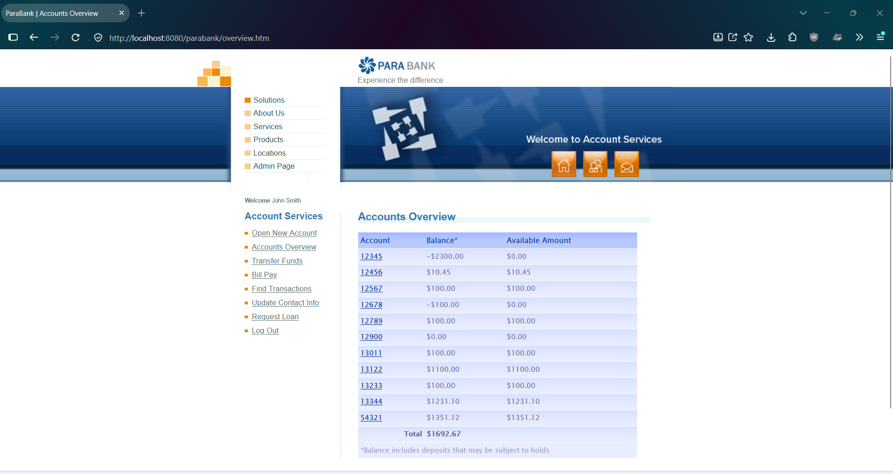
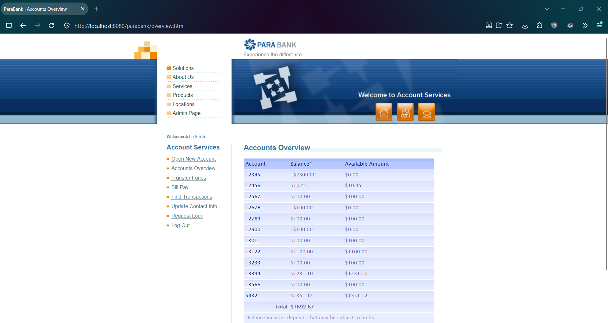
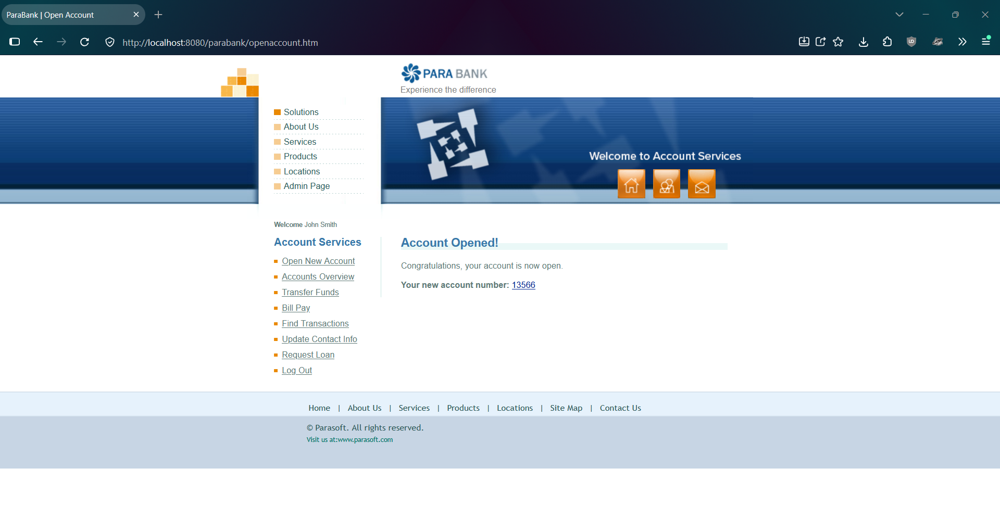

# PBQ-12: Open New Account accepts a funding account holding less than the $100.00 minimum and overdraws it

| Field | Value |
|---|---|
| Status | Open |
| Severity | Major |
| Priority | Medium |
| Feature | F-03 Open New Account |
| Related test cases | TC-F03-04, TC-F03-05, TC-F03-06 |
| Related lead and defects | EO-10, PBQ-4 and PBQ-9 (same missing balance check in Transfer Funds and Bill Pay) |
| Environment | ParaBank (parasoft/parabank, master) run locally on Windows 11, Java 21, default Admin settings, baseline data, user john |
| Reproduced | 2 of 2 attempts for each funding account: (1) each case run separately from a fresh baseline (new account 13566 each time; the attached screenshots are from these runs), (2) all three run in one session without restarting between them (new accounts 13566, 13677, and 13788; same balances and total) |

## Steps to reproduce
1. Restart ParaBank to the baseline and log in as john / demo.
2. Open Accounts Overview. Note account 12456 = 10.45, account 12900 = 0.00, account 12345 = -2300.00, total = 1692.67.
3. Click Open New Account. The page says a minimum of $100.00 must be deposited into the new account.
4. Select CHECKING as the account type and select account 12456 as the funding account.
5. Submit the form.
6. Open Accounts Overview.
7. Repeat steps 1-6, starting from the baseline again each time, with funding account 12900, then with funding account 12345. In these baseline runs the new account number was 13566 every time.

## Expected result
The request is rejected with a clear insufficient-funds message, no account is created, and no balance changes (the page states that a minimum of $100.00 must be deposited; the behavior for insufficient funding is otherwise unspecified, and ParaBank has no requirements document).

## Actual result
In all three cases the account is opened ("Account Opened! Congratulations, your account is now open.") with balance 100.00 and available amount 100.00, and the funding account is overdrawn. The Accounts Overview total stays at 1692.67.

| Funding account | Balance before | Balance after |
|---|---|---|
| 12456 | 10.45 | -89.55 (available 0.00) |
| 12900 | 0.00 | -100.00 (available 0.00) |
| 12345 | -2300.00 | -2400.00 (available 0.00) |

## Impact
The minimum-deposit rule shown on the page is not enforced, and the new account is funded with money the funding account does not have, which silently overdraws it. Severity is Major and not Critical because the total is unchanged and it is not confirmed whether overdrafts are intended (the seeded data contains accounts 12345 and 12678 with negative balances). Transfer Funds and Bill Pay show the same missing balance check (PBQ-4, PBQ-9), while Request Loan rejects a down payment above the account balance, so the application is inconsistent.

## Evidence
Funding account 12456, before:

Funding account 12456, page after submitting:

Funding account 12456, after:

Funding account 12900, before:

Funding account 12900, page after submitting:

Funding account 12900, after:

Funding account 12345, before:

Funding account 12345, page after submitting:

Funding account 12345, after:

