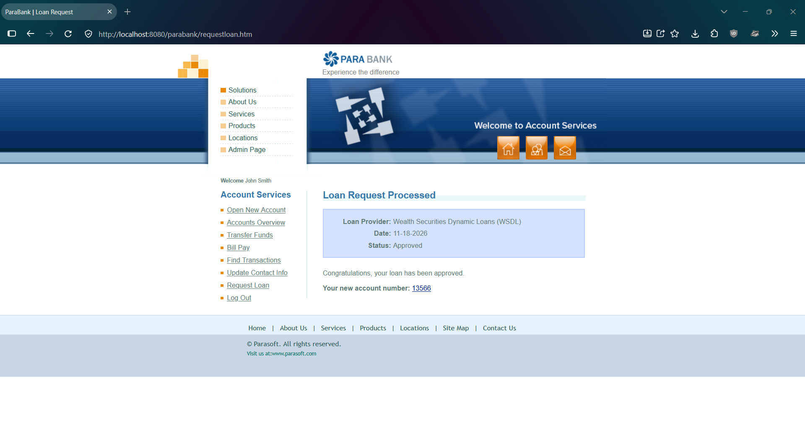
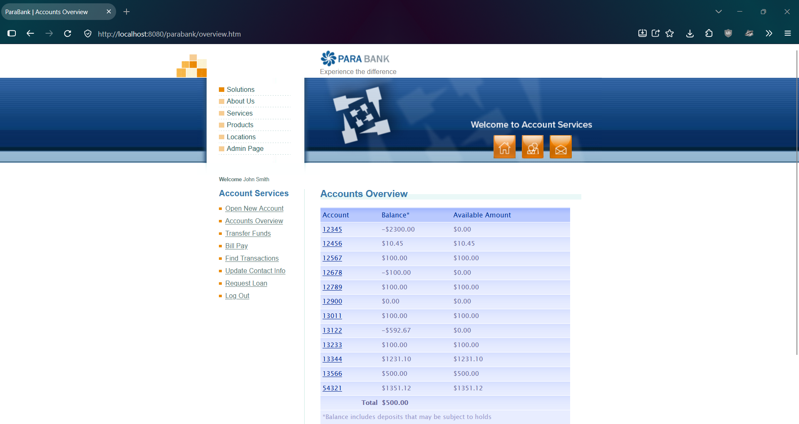
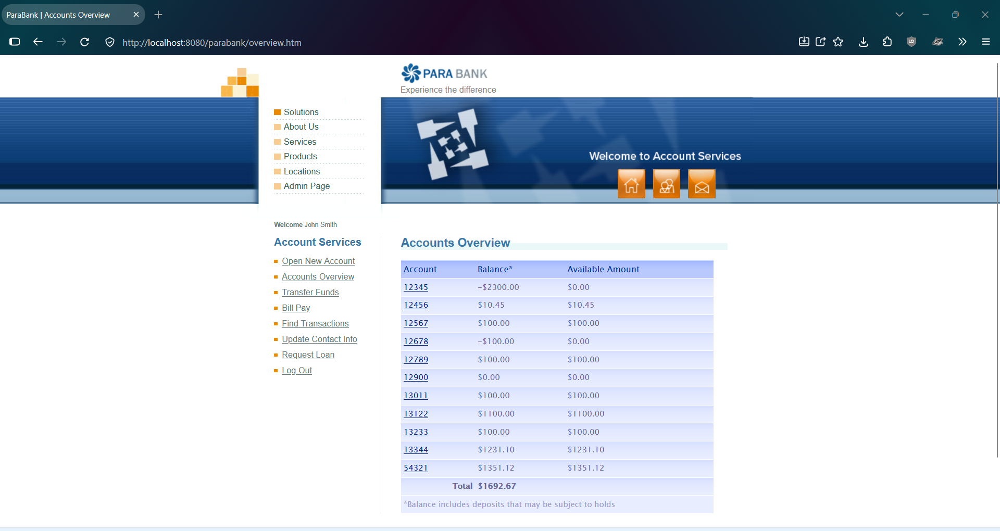

# PBQ-13: Request Loan checks the down payment against the total of all accounts instead of the From account and overdraws the From account

| Field | Value |
|---|---|
| Status | Open |
| Severity | Major |
| Priority | High |
| Feature | F-09 Request Loan |
| Related test case | TC-F09-04 (plus investigation probes INV-03, INV-04, INV-07) |
| Related risk | R-03 |
| Environment | ParaBank (parasoft/parabank, master) run locally on Windows 11, Java 21, default Admin settings (Loan Processor: Available Funds, Threshold: 20), baseline data, user john |
| Reproduced | Scenarios A, B and C: 2 of 2 attempts each (original run and a repeat). Scenario D: observed in 1 run. |

## Steps to reproduce (scenario A)
1. Restart ParaBank to the baseline and log in as john / demo.
2. Open Accounts Overview. Note account 13122 = 1100.00 and total = 1692.67.
3. Click Request Loan.
4. Enter Loan Amount 500.00 and Down Payment 1100.01, and select From account 13122.
5. Submit the application.
6. Open Accounts Overview.

## Further scenarios
Each starts from the baseline and uses the same steps with different values.

| Scenario | Loan Amount | Down Payment | From account |
|---|---|---|---|
| B | 500.00 | 1692.67 | 13122 |
| C | 500.00 | 100.00 | 12456 (balance 10.45) |
| D | 500.00 | 1692.68 | 13122 |

## Expected result
A down payment that the From account cannot cover is rejected with the message "You do not have sufficient funds for the given down payment.", no account is created, and no balance changes (assumption: the down payment is taken from the From account, so that account must cover it; the application has this message for the case where the check fails).

## Actual result

| Scenario | Result | From account after | Total after |
|---|---|---|---|
| A | Approved, new LOAN account with balance 500.00 | 13122 = -0.01 (available 0.00) | 1092.66 |
| B | Approved | 13122 = -592.67 (available 0.00) | 500.00 |
| C | Approved | 12456 = -89.55 (available 0.00) | 2092.67 |
| D | Denied: "You do not have sufficient funds for the given down payment." No account created. | Unchanged | 1692.67 |

The cutoff between approval (down payment 1692.67) and denial (1692.68) is the Accounts Overview total. The down payment therefore appears to be compared with the total of all accounts, while the money is deducted from the selected account.

## Impact
A customer can take a loan with a down payment that the selected account does not hold, and the account is overdrawn by up to the total of all accounts. The overdraft grows with the other accounts' balances, and the application's own message shows that a funds check is intended. Severity is Major because the check exists but tests the wrong balance, and no money is created outside the account totals.

## Evidence
Scenario A, before:

Scenario A, page after submitting:

Scenario A, after:

Scenario B, page after submitting:

Scenario B, after:

Scenario C, page after submitting:

Scenario C, after:

Scenario D, page after submitting (denied):

Scenario D, after (balances unchanged):

