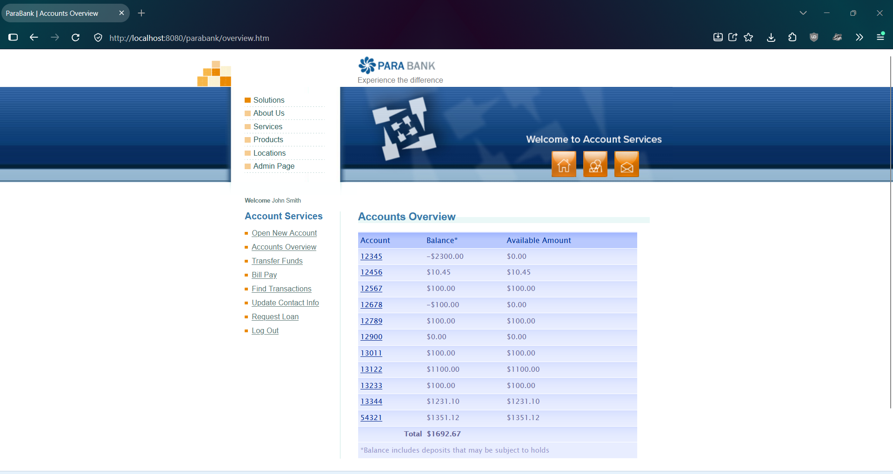
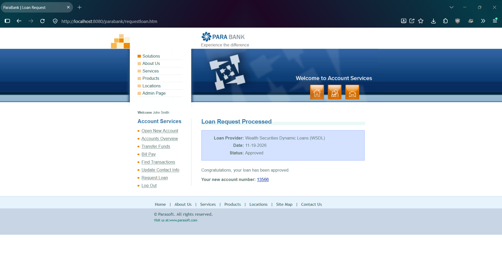
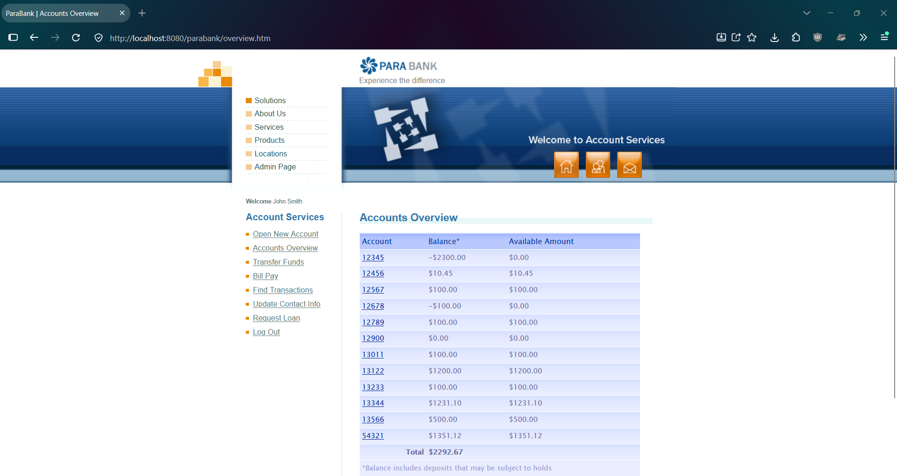

# PBQ-14: Request Loan accepts a negative down payment and adds money to the From account

| Field | Value |
|---|---|
| Status | Open |
| Severity | Critical |
| Priority | High |
| Feature | F-09 Request Loan |
| Related test case | TC-F09-08 |
| Related lead and defects | EO-05, PBQ-3 and PBQ-8 (negative amounts accepted in Transfer Funds and Bill Pay) |
| Environment | ParaBank (parasoft/parabank, master) run locally on Windows 11, Java 21, default Admin settings, baseline data, user john |
| Reproduced | 2 of 2 attempts |

## Steps to reproduce
1. Restart ParaBank to the baseline and log in as john / demo.
2. Open Accounts Overview. Note account 13122 = 1100.00 and total = 1692.67.
3. Click Request Loan.
4. Enter Loan Amount 500.00 and Down Payment -100.00, and select From account 13122.
5. Submit the application.
6. Open Accounts Overview.

## Expected result
The request is rejected with a clear message and no balance changes (assumption: a negative down payment has no meaning; ParaBank has no requirements document).

## Actual result
The loan is approved (Status: Approved) and a new LOAN account with balance 500.00 is created. Account 13122 increases by 100.00 to 1200.00 and the Accounts Overview total rises to 2292.67.

## Impact
The down payment should leave the From account, but a negative value adds the money to it, with no matching deduction anywhere. For comparison, the same loan with a down payment of 100.00 gives a total of 2092.67, so the total here is 200.00 higher than it should be. Money is created, as with the negative amount in Bill Pay (PBQ-8). The loan balance being added to the total is a separate open question and is not counted as part of this defect.

## Evidence
Before the request:

Page after submitting the application:

After the request:

