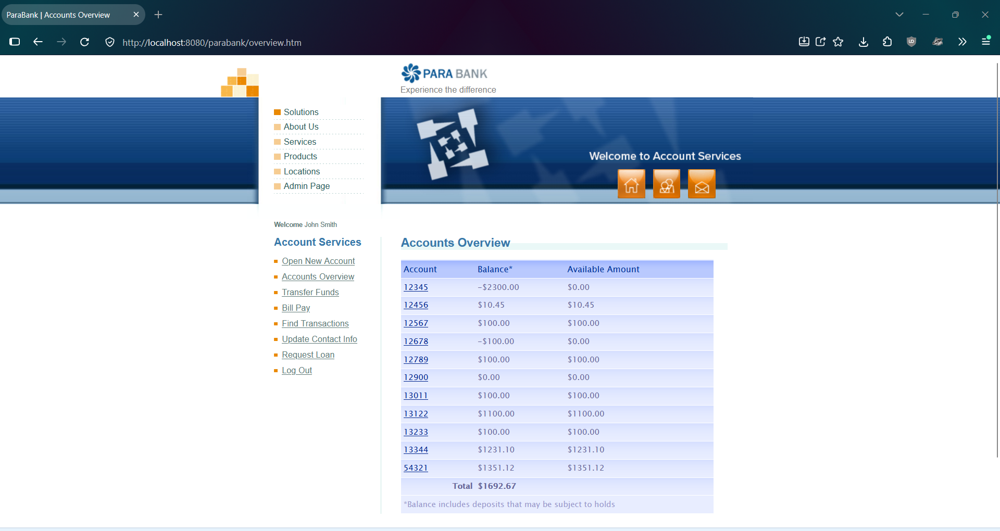
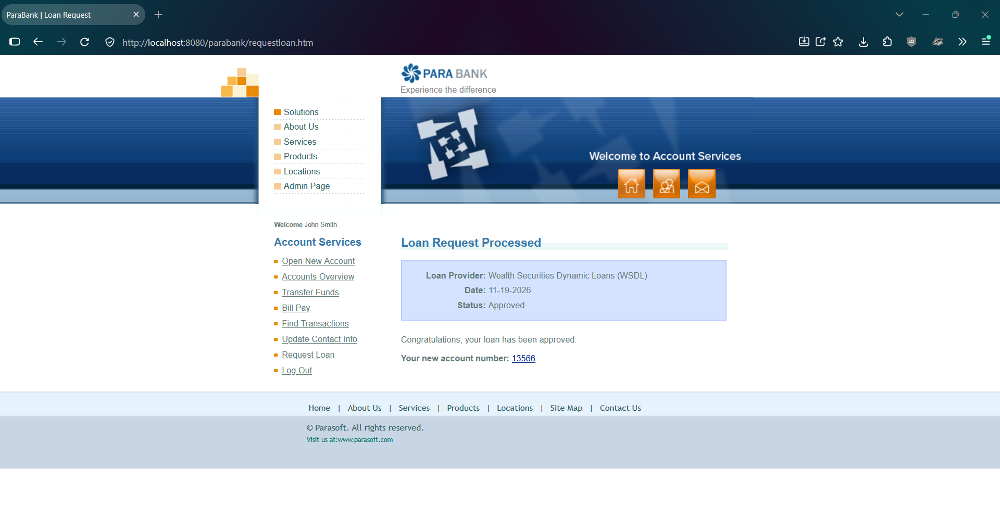
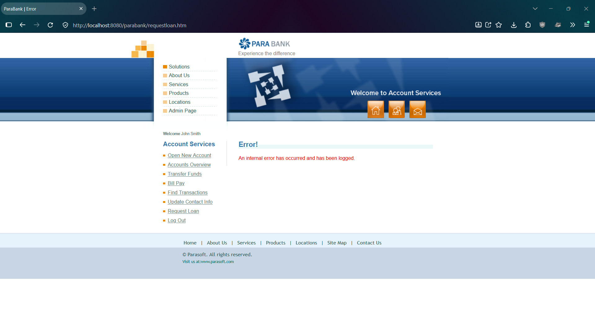

# PBQ-15: Request Loan accepts a loan amount with more than two decimal places, then most of the site shows an internal error until ParaBank is restarted

| Field | Value |
|---|---|
| Status | Open |
| Severity | Critical |
| Priority | High |
| Feature | F-09 Request Loan |
| Related test case | TC-F09-13 |
| Related leads and defects | EO-03, R-04, PBQ-5 and PBQ-11 (same failure triggered from Transfer Funds and Bill Pay) |
| Environment | ParaBank (parasoft/parabank, master) run locally on Windows 11, Java 21, default Admin settings, baseline data, user john |
| Reproduced | 2 of 2 attempts |

## Steps to reproduce
1. Restart ParaBank to the baseline and log in as john / demo.
2. Open Accounts Overview. Note account 13122 = 1100.00 and total = 1692.67.
3. Click Request Loan.
4. Enter Loan Amount 500.001 and Down Payment 100.00, and select From account 13122.
5. Submit the application.
6. Click Accounts Overview, then the other menu items.

## Expected result
A clear validation message is shown (or the amount is handled consistently), balances stay correct, and the rest of the site keeps working (assumption: invalid input should not break the site; ParaBank has no requirements document).

## Actual result
- The result page shows Status: Approved and a new account number (13566). The page does not show the loan amount, so it is not known how 500.001 was treated.
- After that, Accounts Overview, Transfer Funds, Bill Pay, Find Transactions, and Request Loan show "Error! An internal error has occurred and has been logged." Open New Account shows its normal page for a split second, then the same error.
- Update Contact Info loads normally.
- Logging out and logging back in works, but Accounts Overview still shows the error.
- Restarting ParaBank restores normal behavior.
- It was not possible to check the new account or the balances, because Accounts Overview never loaded.

## Impact
One input with three decimal places leaves the session unable to view accounts or transactions, make transfers, pay bills, request loans, or open accounts, and logging out does not recover it. Only a restart of the application does. In this case a loan is also reported as approved while its effect cannot be checked.

## Possible cause (unconfirmed)
This is the same failure as PBQ-5 and PBQ-11, triggered from a third feature, so the cause may be shared code that handles amounts or stores transactions. It is filed separately because it is a separate entry point.

## Evidence
Accounts Overview before the request:

Result page after submitting the application:

Accounts Overview immediately afterwards:

Request Loan page immediately afterwards:

Update Contact Info still working:

After logging out and logging back in, Accounts Overview:

