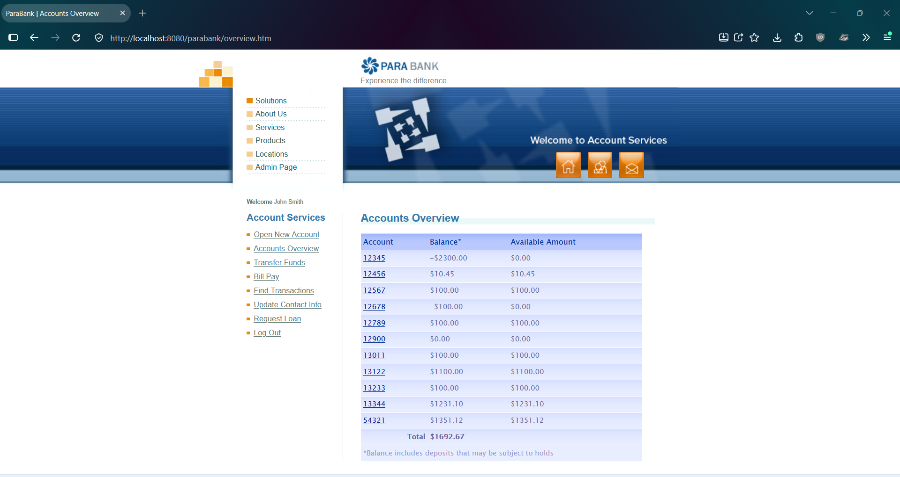
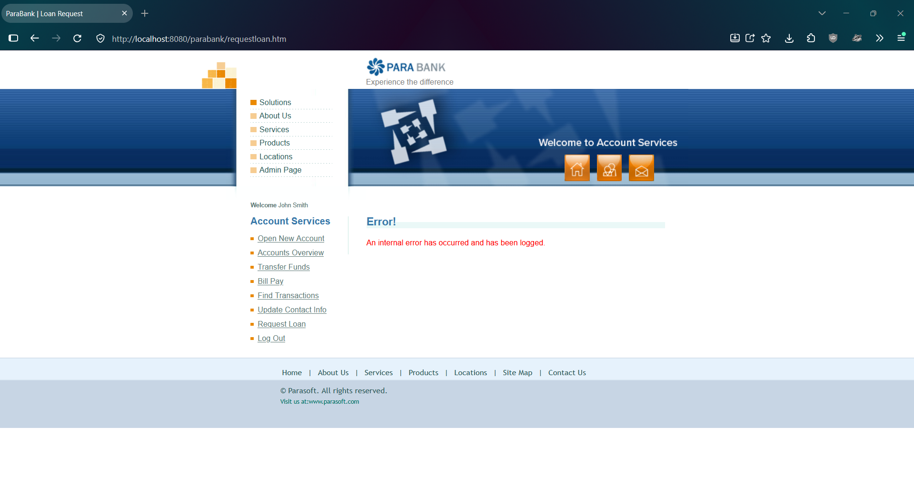

# PBQ-16: Request Loan shows a generic internal error for a zero, non-numeric or empty loan amount instead of a validation message

| Field | Value |
|---|---|
| Status | Open |
| Severity | Minor |
| Priority | Medium |
| Feature | F-09 Request Loan |
| Related test cases | TC-F09-09, TC-F09-11, TC-F09-12 |
| Related lead and defect | EO-04, PBQ-6 (same behavior in Transfer Funds) |
| Environment | ParaBank (parasoft/parabank, master) run locally on Windows 11, Java 21, default Admin settings, baseline data, user john |
| Reproduced | 2 of 2 attempts for each input (balances matched the baseline before each attempt) |

## Steps to reproduce (zero amount)
1. Restart ParaBank to the baseline and log in as john / demo.
2. Open Accounts Overview. Note account 13122 = 1100.00 and total = 1692.67.
3. Click Request Loan.
4. Enter Loan Amount 0.00 and Down Payment 100.00, and select From account 13122.
5. Submit the application.
6. Open Accounts Overview.

## Steps to reproduce (non-numeric amount)
Same as above, but enter abc as the Loan Amount in step 4.

## Steps to reproduce (empty amount)
Same as above, but leave the Loan Amount empty in step 4.

## Expected result
A clear validation message is shown (for example, that the loan amount must be a positive number), no account is created, no balances change, and the form can be corrected and resubmitted (assumption: normal input validation; ParaBank has no requirements document).

## Actual result
In all three cases the page shows "Error! An internal error has occurred and has been logged." No account is created, balances are unchanged (13122 = 1100.00, total = 1692.67), and Accounts Overview and the other features keep working.

## Impact
The user gets no indication of what is wrong with the input. Bill Pay validates the same kinds of input with a clear message beside each field (TC-F06-08 and TC-F06-09), while Request Loan and Transfer Funds (PBQ-6) show only the generic error, so validation is inconsistent across the application. Severity is Minor because no money moves and the rest of the site keeps working, unlike the failure with more than two decimals (PBQ-15).

## Evidence
Zero amount, before:

Zero amount, page after submitting:

Zero amount, Accounts Overview afterwards:

Non-numeric amount, before:

Non-numeric amount, page after submitting:

Non-numeric amount, Accounts Overview afterwards:

Empty amount, before:

Empty amount, page after submitting:

Empty amount, Accounts Overview afterwards:

