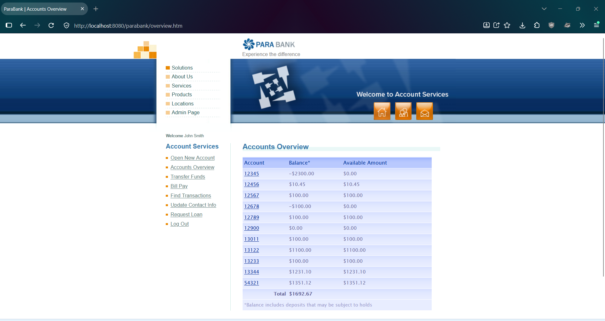
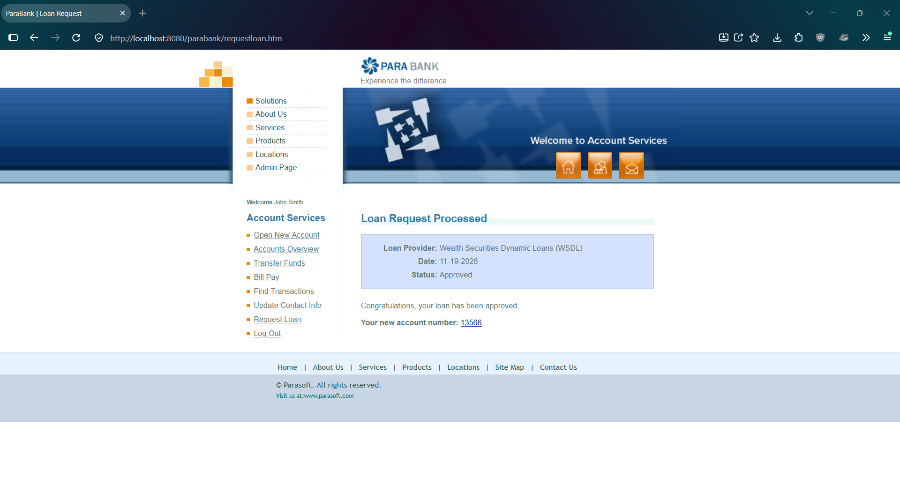
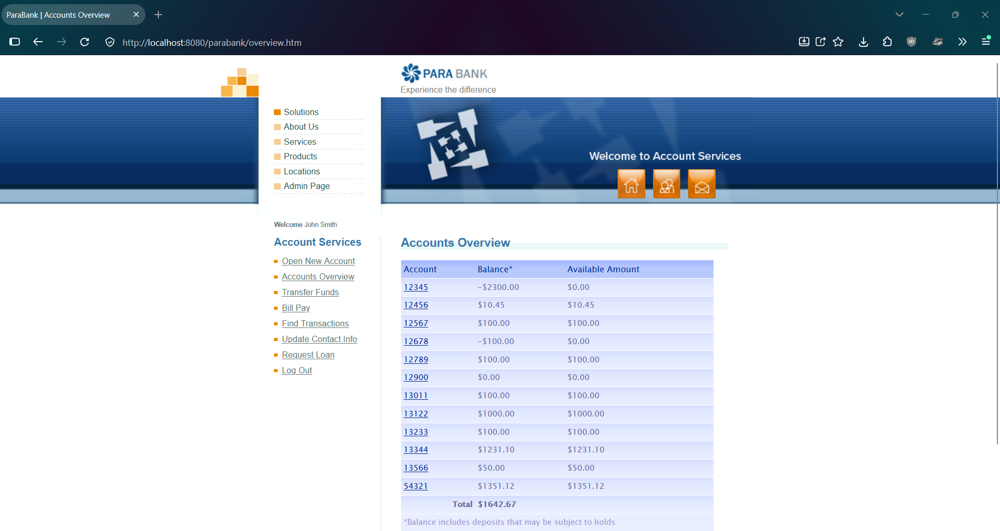

# PBQ-17: Request Loan approves a loan whose down payment is larger than the loan amount

| Field | Value |
|---|---|
| Status | Open |
| Severity | Minor |
| Priority | Low |
| Feature | F-09 Request Loan |
| Related test case | TC-F09-10 |
| Related lead and defect | EO-05, PBQ-14 (same missing check of the down payment's value in Request Loan) |
| Environment | ParaBank (parasoft/parabank, master) run locally on Windows 11, Java 21, default Admin settings, baseline data, user john |
| Reproduced | 2 of 2 attempts |

## Steps to reproduce
1. Restart ParaBank to the baseline and log in as john / demo.
2. Open Accounts Overview. Note account 13122 = 1100.00 and total = 1692.67.
3. Click Request Loan.
4. Enter Loan Amount 50.00 and Down Payment 100.00, and select From account 13122.
5. Submit the application.
6. Open Accounts Overview.

## Expected result
The request is rejected with a clear message and no balance changes (assumption: a down payment larger than the loan amount is not meaningful; ParaBank has no requirements document and the intended rule is unknown).

## Actual result
The loan is approved (Status: Approved) and a new LOAN account with balance 50.00 is created. Account 13122 decreases by 100.00 to 1000.00 and the Accounts Overview total is 1642.67.

## Impact
The customer pays a down payment of 100.00 on a loan of 50.00, so they pay more than the loan is worth. Severity is Minor and priority Low because the intended rule is unknown and the amounts are consistent with the entered values (1692.67 minus 100.00 plus 50.00 is 1642.67).

## Evidence
Before the request:

Page after submitting the application:

After the request:

