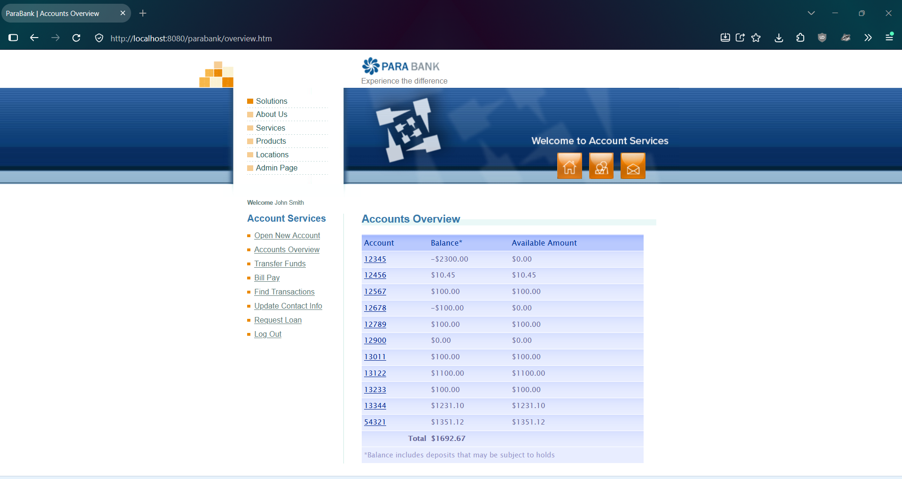
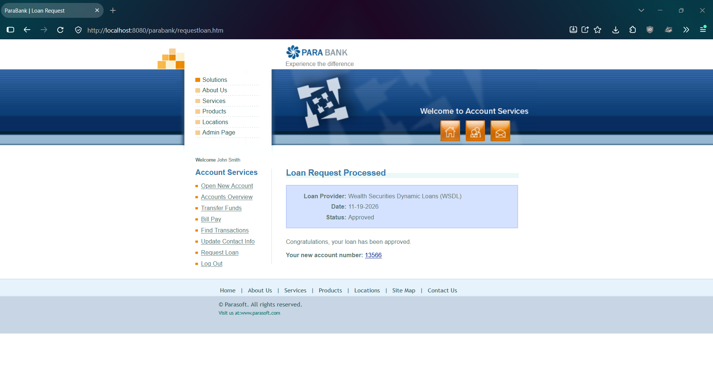
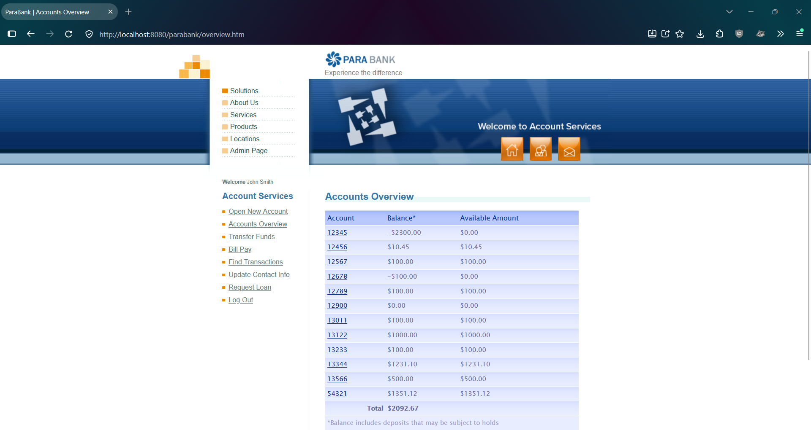
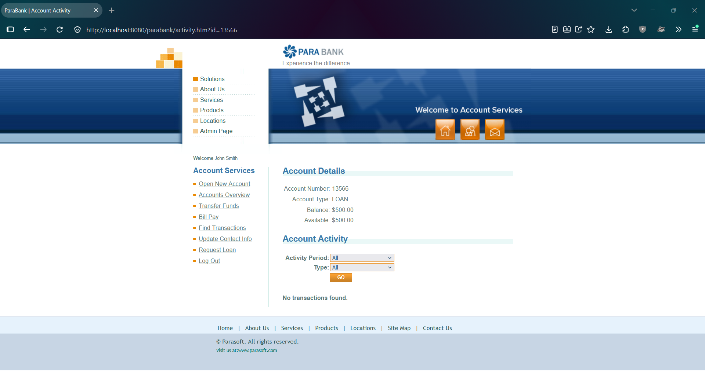
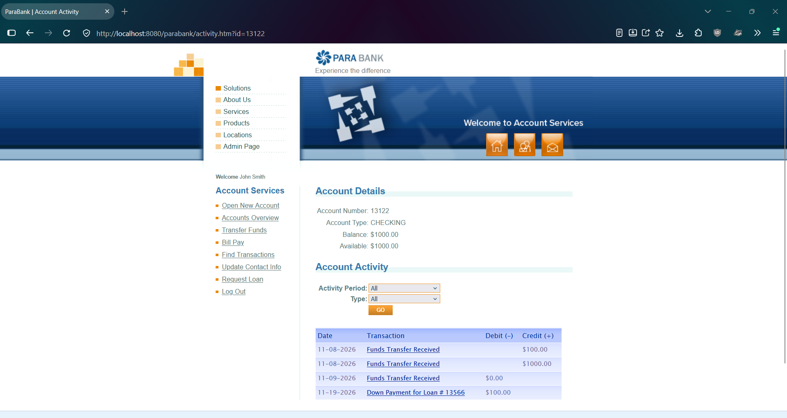
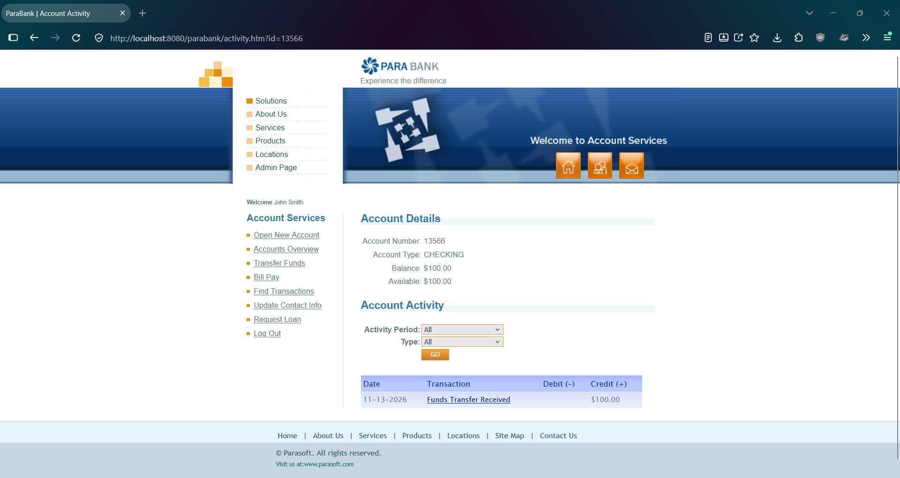

# PBQ-18: Request Loan creates a loan account with a balance but no transaction in its Account Activity

| Field | Value |
|---|---|
| Status | Open |
| Severity | Minor |
| Priority | Medium |
| Feature | F-09 Request Loan |
| Related test case | TC-F09-14 |
| Environment | ParaBank (parasoft/parabank, master) run locally on Windows 11, Java 21, default Admin settings, baseline data, user john |
| Reproduced | 2 of 2 attempts |

## Steps to reproduce
1. Restart ParaBank to the baseline and log in as john / demo.
2. Open Accounts Overview. Note account 13122 = 1100.00 and total = 1692.67.
3. Click Request Loan.
4. Enter Loan Amount 500.00 and Down Payment 100.00, and select From account 13122.
5. Submit the application and note the new account number.
6. Open Accounts Overview and click the new account number.
7. Check Account Activity of the new account, then check Account Activity of account 13122.

## Expected result
The new account's Account Activity shows an entry for the 500.00 (assumption: consistent with Open New Account, where the opening deposit appears in the new account's history; ParaBank has no requirements document and the intended behavior is unknown).

## Actual result
The new LOAN account is listed with balance 500.00, but its Account Activity is empty. Account 13122 shows an entry "Down Payment for Loan # [new account number]", Debit, $100.00.

## Impact
The new account's balance has no transaction behind it, so the balance cannot be traced in the account history. The down payment is recorded on the From account while the loan amount is not recorded on the new account. For comparison, a new account opened through Open New Account shows its 100.00 opening deposit as a credit in its Account Activity (TC-F03-07). Severity is Minor because the amounts agree with each other and no money is lost, and priority is Medium because the missing record weakens the audit trail.

## Evidence
Before the request:

Page after submitting the application:

Accounts Overview after the request:

Account Activity of the new loan account (empty):

Account Activity of account 13122 (down payment entry):

Comparison: Account Activity of a new account from Open New Account, which shows its opening deposit (TC-F03-07):

