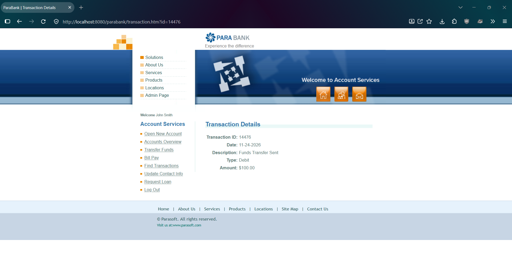
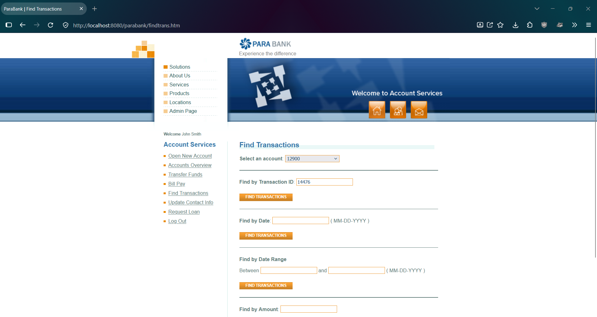
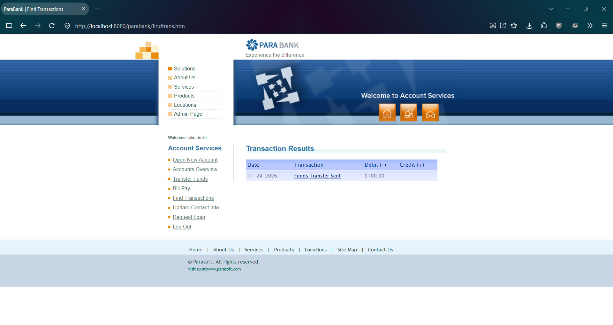
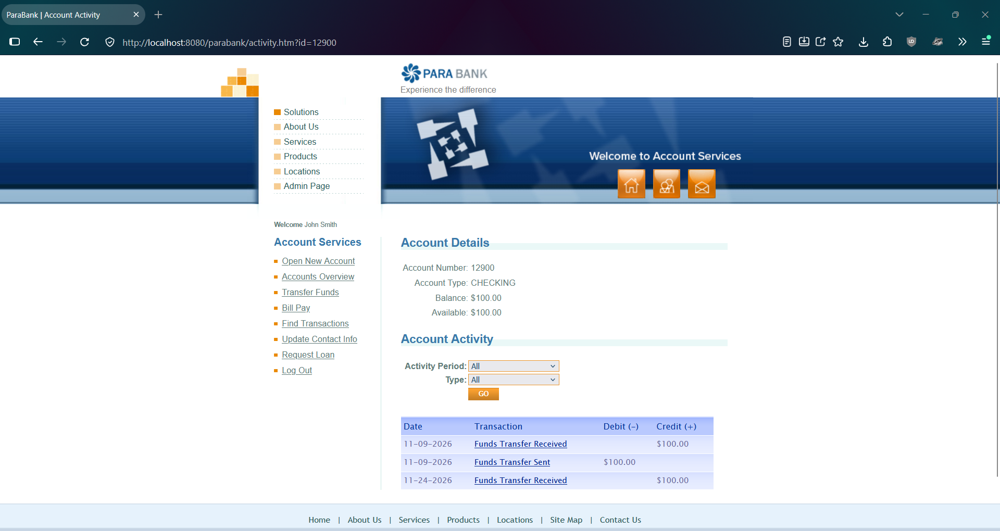

# PBQ-19: Find Transactions by transaction ID ignores the selected account and lists a transaction that belongs to a different account

| Field | Value |
|---|---|
| Status | Open |
| Severity | Minor |
| Priority | Low |
| Feature | F-07 Find Transactions |
| Related test case | TC-F07-03 |
| Related lead | EO-06 |
| Environment | ParaBank (parasoft/parabank, master) run locally on Windows 11, Java 21, default Admin settings, baseline data, user john |
| Reproduced | 2 of 2 attempts |

## Steps to reproduce
1. Restart ParaBank to the baseline and log in as john / demo.
2. Open Accounts Overview. Note account 13122 = 1100.00 and total = 1692.67.
3. Click Transfer Funds. Transfer 100.00 from account 13122 to account 12900.
4. Open Account Activity of account 13122, click the new "Funds Transfer Sent" entry (Debit $100.00), and note its Transaction ID (14476).
5. Click Find Transactions.
6. Select account 12900 in the account dropdown.
7. Enter 14476 in the Find by Transaction ID field and click its search button.
8. Open Account Activity of account 12900 and check whether it contains that transaction.

## Expected result
No transaction is shown for account 12900, or a clear message says none was found (assumption: results are limited to the selected account; ParaBank has no requirements document).

## Actual result
The search lists "Funds Transfer Sent", Debit $100.00 (ID 14476) even though account 12900 is selected. That transaction belongs to account 13122; account 12900 only has the matching credit, with a different ID.

## Impact
The account dropdown has no effect on this search mode, so the page can show a transaction that does not belong to the selected account. A user could misread which account the transaction was made on. Severity is Minor and priority Low because all the accounts involved belong to the same customer. The amount search respects the selected account (see TC-F07-13), so the inconsistency is limited to the transaction ID search. A follow-up test showed that the same search also lists transactions that belong to a different customer (see PBQ-20), which is a much more serious issue.

## Evidence
Transaction Details of the setup transfer (the debit on account 13122):

Find Transactions with account 12900 selected and the ID of the 13122 debit entered:

Result: the debit that belongs to 13122 is listed:

Account Activity of account 12900, which does not contain that debit:

Comparison: the same search with the correct account (13122) selected:

