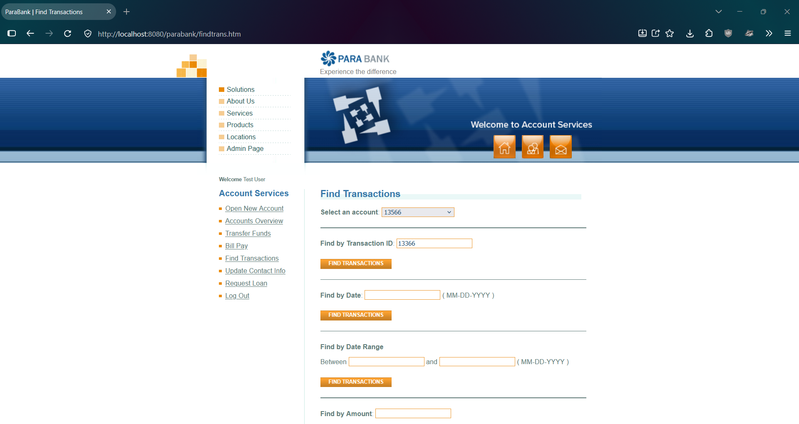
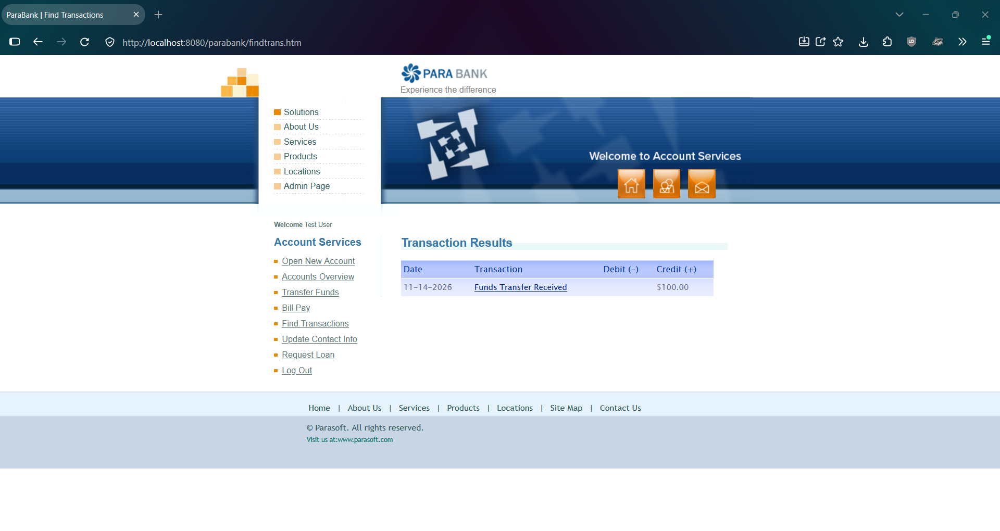
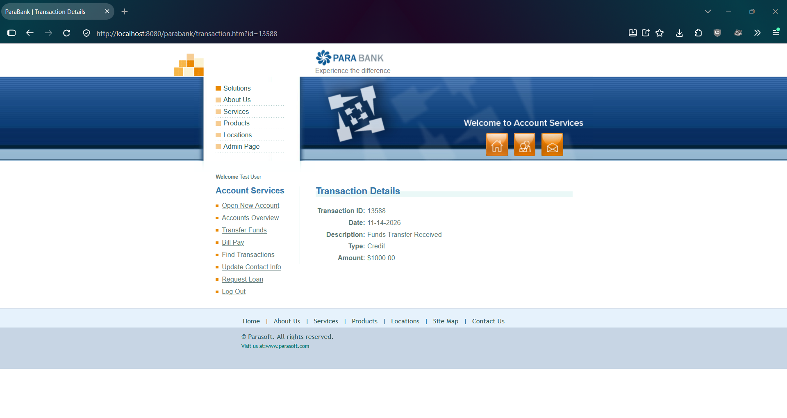

# PBQ-20: Find Transactions by transaction ID shows transactions that belong to a different customer

| Field | Value |
|---|---|
| Status | Open |
| Severity | Critical |
| Priority | High |
| Feature | F-07 Find Transactions (found while testing F-01 Register) |
| Related test case | TC-F01-10 |
| Related defect | PBQ-19 (the same search ignores the selected account) |
| Environment | ParaBank (parasoft/parabank, master) run locally on Windows 11, Java 21, default Admin settings, baseline data, users john and tester01 |
| Reproduced | 3 of 3 attempts (ID 13366 in the original run and in a repeat, ID 13588 in the repeat) |

## Steps to reproduce
1. Restart ParaBank to the baseline and log in as john / demo.
2. Open Account Activity of account 13122 and note two seeded transactions: ID 13366 (Funds Transfer Received, Credit $100.00, dated 11-14-2026) and ID 13588 (Funds Transfer Received, Credit $1000.00, dated 11-14-2026).
3. Click Log Out.
4. Click Register and register a new customer (username tester01, with made-up details). The new customer has one account, 13566.
5. Click Find Transactions and select account 13566.
6. Enter 13366 in the Find by Transaction ID field and click its search button.
7. Click the transaction in the result to open its Transaction Details.
8. Repeat steps 5-7 with 13588.
9. Control: repeat steps 5-6 with 99999999.

## Expected result
No transaction is shown, or a clear message says none was found, because the transactions belong to a different customer (assumption: customers cannot see each other's transactions; ParaBank has no requirements document, and the Accounts Overview and account dropdowns do keep customers apart, see TC-F01-09).

## Actual result
- Both transactions are listed for tester01, and their Transaction Details show the same ID, date, description, type and amount that john sees.
- The control ID 99999999 returns an empty table with only the column headings, so the search only returns real transactions, whoever they belong to.
- The details pages show only the transaction ID, date, description, type and amount. They do not show an account number or customer name. The "Welcome" panel shows the name of the logged-in user, not the owner of the transaction.

## Impact
Any logged-in customer can read the details of another customer's transactions by entering a transaction ID. The Accounts Overview and the account lists correctly keep customers apart, so the gap is in this one search. The exposed details are the date, description, type and amount. The seeded IDs observed are numeric and fall in a similar range (12922 to 14476), but guessing was not tested. Not tested: transactions created by other customers after startup, and access from outside the browser pages.

## Evidence
Search form as tester01 with the new customer's own account (13566) selected:

Transaction 13366 as john:

Transaction 13588 as john:

Search for 13366 as tester01:

Transaction Details of 13366 as tester01:

Search for 13588 as tester01:

Transaction Details of 13588 as tester01:

Control search for a non-existent ID (99999999):

