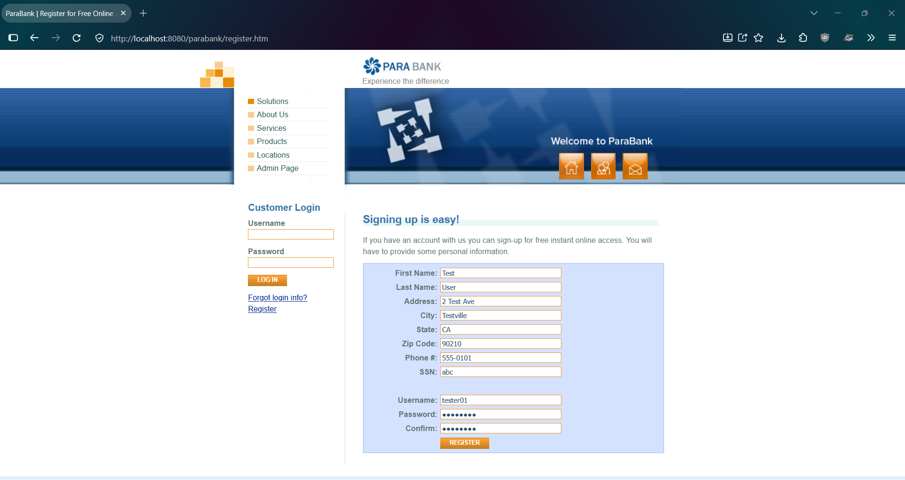
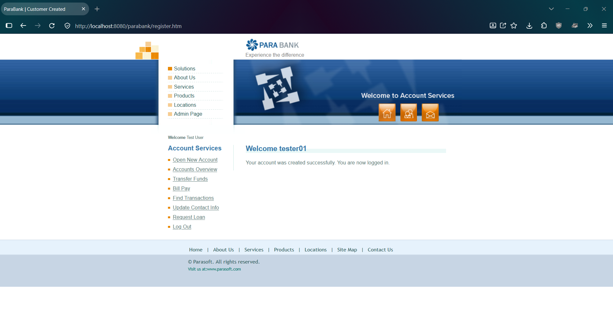
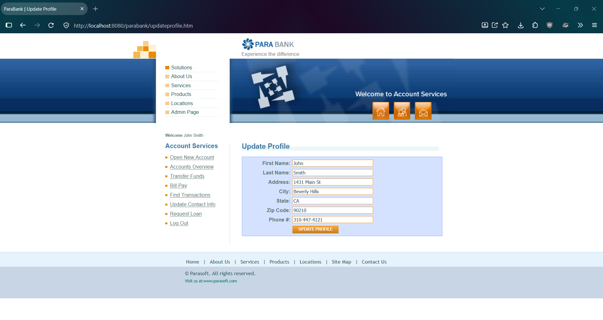

# PBQ-21: Register and Update Contact Info accept and store invalid values for SSN, phone number and zip code

| Field | Value |
|---|---|
| Status | Open |
| Severity | Minor |
| Priority | Medium |
| Features | F-01 Register, F-08 Update Contact Info |
| Related test cases | TC-F01-05, TC-F01-06, TC-F01-07, TC-F08-03, TC-F08-04 |
| Related lead | EO-08 |
| Environment | ParaBank (parasoft/parabank, master) run locally on Windows 11, Java 21, default Admin settings, baseline data |
| Reproduced | 2 of 2 attempts for each field (original run and a repeat) |

## Steps to reproduce (Register)
1. Restart ParaBank to the baseline and make sure you are logged out.
2. Click Register.
3. Fill in the form with valid made-up details (First Name: Test; Last Name: User; Address: 2 Test Ave; City: Testville; State: CA; Zip Code: 90210; Phone #: 555-0101; SSN: 000-00-0000; Username: tester01; Password: Test1234; Confirm: Test1234), but enter abc as the SSN.
4. Submit the form.
5. Repeat steps 1-4 (restarting each time) with abc as the Phone # instead, then with abc as the Zip Code instead.

## Steps to reproduce (Update Contact Info)
1. Restart ParaBank to the baseline and log in as john / demo.
2. Click Update Contact Info.
3. Replace the Phone # with abc and submit.
4. Click Update Contact Info again and check the stored values.
5. Repeat with abc as the Zip Code.

## Expected result
The form is rejected with a clear message about the field's format and nothing is stored (assumption: SSN, phone number and zip code have a recognizable format; ParaBank has no requirements document).

## Actual result
- **Register:** with abc as the SSN, the phone number or the zip code, the registration succeeds ("Welcome tester01 / Your account was created successfully. You are now logged in.") with no message about the field.
- **Update Contact Info:** with abc as the phone number or the zip code, the page shows "Profile Updated / Your updated address and phone number have been added to the system.", and reopening the form shows abc stored in that field.

## Impact
Invalid values are accepted and stored in the customer record, in two features. Required fields are validated (see TC-F01-04 and TC-F08-02), so format checks are the missing piece. Severity is Minor because no money moves. The effect on other features that use these values was not tested. Not covered by a test case: format checks for the other text fields, and the payee fields in Bill Pay and the Contact Us form, which also accepted any text during exploring.

## Evidence
Register with abc as the SSN, form and result:

Register with abc as the phone number:

Register with abc as the zip code:

Update Contact Info, john's original details:

Update Contact Info with abc as the phone number: form, result, and the stored value afterwards:

Update Contact Info with abc as the zip code: form, result, and the stored value afterwards:

