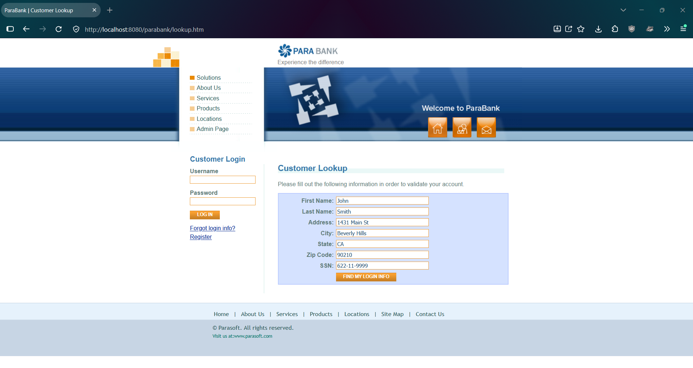
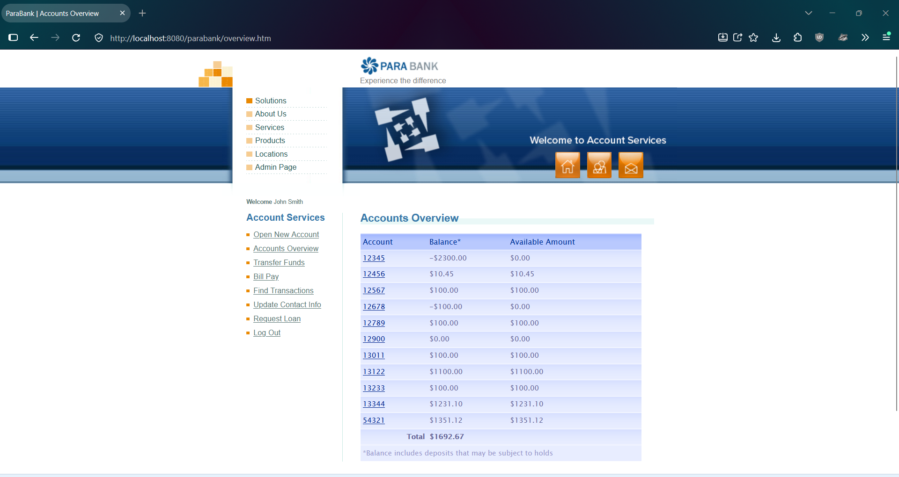
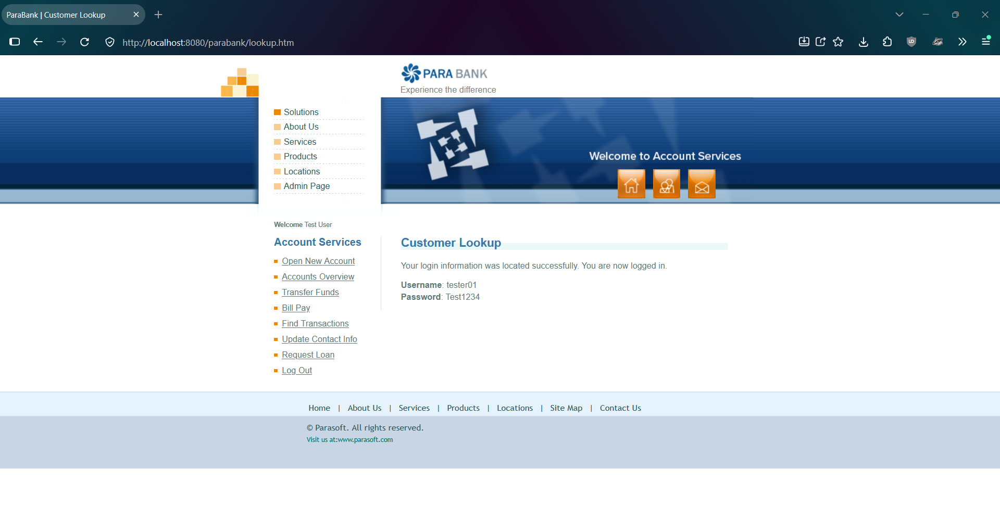

# PBQ-22: Forgot login info? displays the customer's username and password in plain text and logs the user in, and appears to need only a matching SSN

| Field | Value |
|---|---|
| Status | Open |
| Severity | Critical |
| Priority | High |
| Feature | Forgot login info? (not in the original feature inventory; added after exploratory testing) |
| Related test cases | None yet (found during exploratory testing) |
| Environment | ParaBank (parasoft/parabank, master) run locally on Windows 11, Java 21, default Admin settings, baseline data. All personal details used are made up (john's are ParaBank's built-in demo data). |
| Reproduced | 2 of 2 attempts for john and 2 of 2 for tester01 (original run and a repeat). The two single-field tests (wrong first name, wrong zip) were observed once each. |

## Steps to reproduce
1. Restart ParaBank to the baseline and make sure you are logged out.
2. In the login panel, click "Forgot login info?".
3. Enter john's details: First Name John, Last Name Smith, Address 1431 Main St, City Beverly Hills, State CA, Zip Code 90210, SSN 622-11-9999.
4. Click FIND MY LOGIN INFO.
5. Without logging in, click Accounts Overview, then Update Contact Info.
6. Repeat with a customer registered through Register (tester01, made-up details), then with a correct SSN but a wrong First Name only, and with a correct SSN but a wrong Zip Code only.

## Expected result
A recovery flow that does not reveal the password and does not log the user in, for example by sending a one-time reset link or code to the contact details registered earlier, with a generic message for every outcome (assumption: standard account-recovery practice; ParaBank has no requirements document).

## Actual result
- With matching details, the page shows "Your login information was located successfully. You are now logged in." with the username and the password in plain text (john / demo, tester01 / Test1234).
- The user is then logged in without entering a password: Accounts Overview shows the customer's accounts and total (john: 11 accounts, total 1692.67; tester01: account 13566, 515.50), and Update Contact Info shows the full name, address and phone number.
- A wrong SSN gives "Error! The customer information provided could not be found."
- A wrong First Name alone, or a wrong Zip Code alone, with the correct SSN, still succeeds and shows the username and password.

## Impact
Anyone who knows a customer's SSN can read the customer's password and take over the account, with access to balances, transactions, transfers, bill payments and personal details. The lookup appears to be decided by the SSN alone; this is inferred from two single-field tests (first name and zip code). Not tested: wrong last name, address, city or state; several wrong fields at once; whether other SSNs than the ones used behave the same; any limit on repeated attempts. Showing the password also suggests that passwords are stored in a form that can be read back, which is not confirmed.

## Evidence
john's details entered, and the result:

Repeat for john:

Without logging in, Accounts Overview shows john's accounts:

Without logging in, Update Contact Info shows john's personal details:

tester01, original lookup and repeat, then Accounts Overview afterwards:

Comparison: a wrong SSN is rejected with a generic message:

Correct SSN with a wrong First Name only:

Correct SSN with a wrong Zip Code only:

