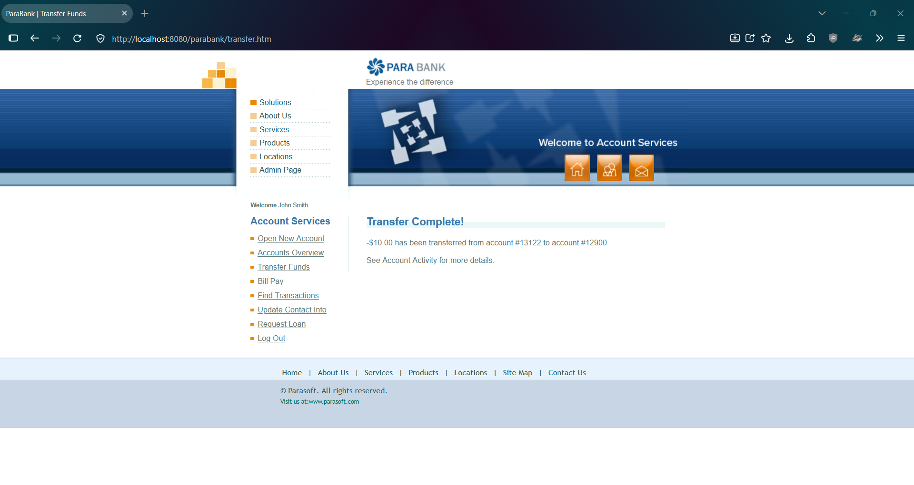
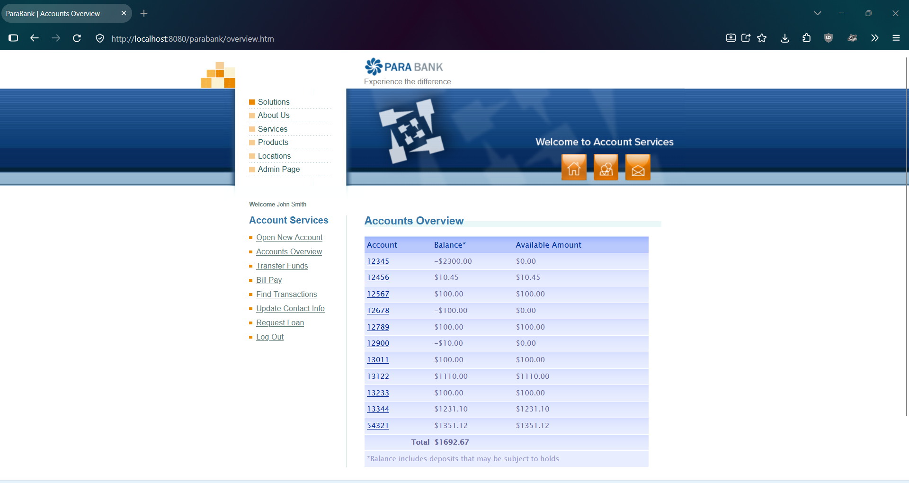

# PBQ-3: Transfer Funds accepts a negative amount and moves money in the reverse direction

| Field | Value |
|---|---|
| Status | Open |
| Severity | Critical |
| Priority | High |
| Feature | F-05 Transfer Funds |
| Related test case | TC-F05-06 |
| Related lead | EO-01 |
| Environment | ParaBank (parasoft/parabank, master) run locally on Windows 11, Java 21, default Admin settings, baseline data, user john |
| Reproduced | 2 of 2 attempts |

## Steps to reproduce
1. Restart ParaBank to the baseline and log in as john / demo.
2. Open Accounts Overview. Note account 13122 = 1100.00, account 12900 = 0.00, total = 1692.67.
3. Click Transfer Funds.
4. Enter -10.00 as the amount, select From account 13122 and To account 12900.
5. Click Transfer.
6. Open Accounts Overview.

## Expected result
The transfer is rejected with a clear message and no balance changes (assumption: normal banking rule; ParaBank has no requirements document).

## Actual result
The transfer is accepted. Account 13122 = 1110.00 (up 10.00) and account 12900 = -10.00 (down 10.00, available amount 0.00). Money moved from the To account to the From account. The overview total stays at 1692.67.

## Impact
There is no validation on the amount, so a user can reverse the direction of a transfer and push the To account negative.

## Evidence
Before the transfer:

Transfer page after clicking Transfer:

After the transfer:

