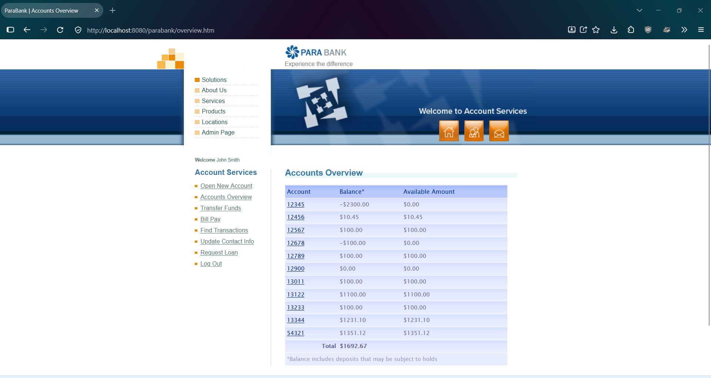
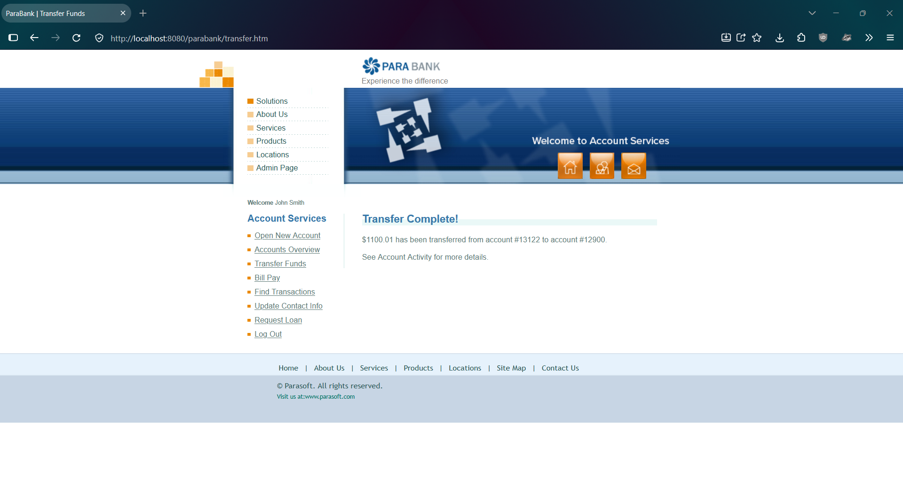

# PBQ-4: Transfer Funds accepts an amount greater than the available balance and overdraws the From account

| Field | Value |
|---|---|
| Status | Open |
| Severity | Major |
| Priority | Medium |
| Feature | F-05 Transfer Funds |
| Related test case | TC-F05-04 |
| Related lead | EO-02 |
| Environment | ParaBank (parasoft/parabank, master) run locally on Windows 11, Java 21, default Admin settings, baseline data, user john |
| Reproduced | 2 of 2 attempts |

## Steps to reproduce
1. Restart ParaBank to the baseline and log in as john / demo.
2. Open Accounts Overview. Note account 13122 = 1100.00, account 12900 = 0.00, total = 1692.67.
3. Click Transfer Funds.
4. Enter 1100.01 as the amount, select From account 13122 and To account 12900.
5. Click Transfer.
6. Open Accounts Overview.

## Expected result
The transfer is rejected with a clear insufficient-funds message and no balance changes (assumption: normal banking rule; ParaBank has no requirements document, and the intended overdraft rule is unknown).

## Actual result
The transfer is accepted. Account 13122 = -0.01 (available amount 0.00) and account 12900 = 1100.01. The overview total stays at 1692.67.

## Impact
A transfer can exceed the available balance, so accounts can be overdrawn by transfers. Severity is Major and not Critical because it is not confirmed whether overdrafts are intended (the seeded data contains accounts 12345 and 12678 with negative balances). Request Loan does reject a down payment above the account balance, so the application is inconsistent.

## Evidence
Before the transfer:

Transfer page after clicking Transfer:

After the transfer:

