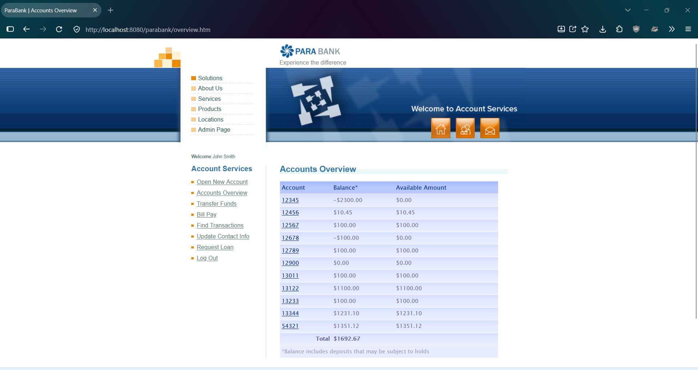
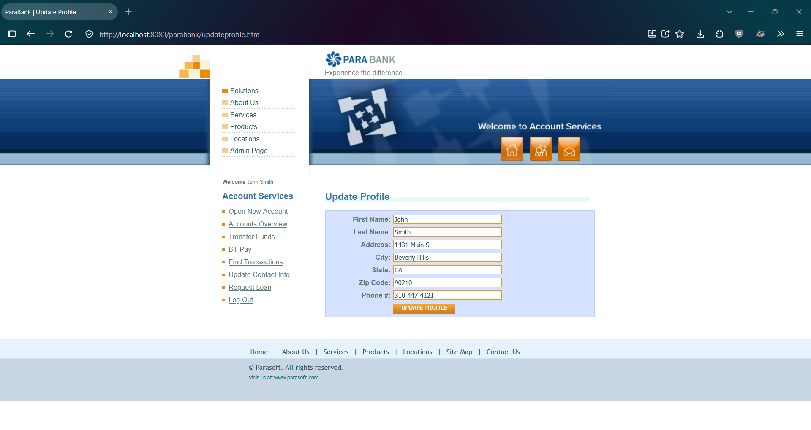
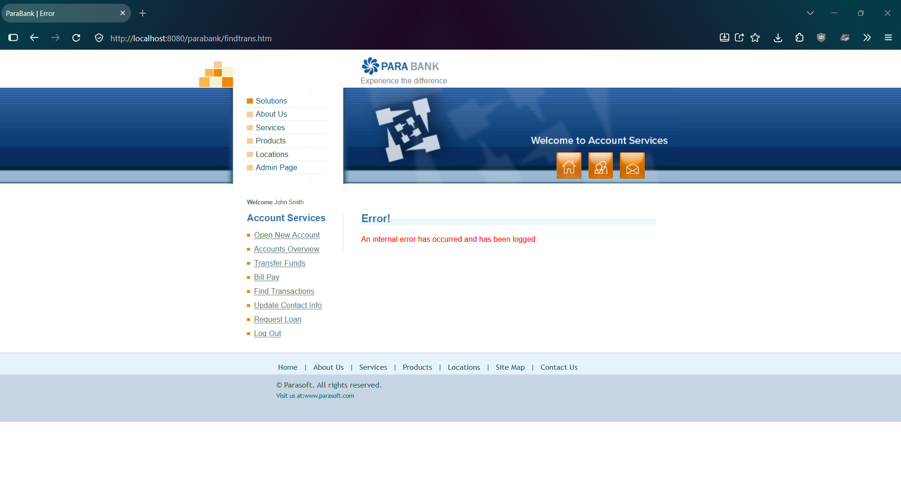

# PBQ-5: Transfer Funds accepts an amount with more than two decimal places, then most of the site shows an internal error until ParaBank is restarted

| Field | Value |
|---|---|
| Status | Open |
| Severity | Critical |
| Priority | High |
| Feature | F-05 Transfer Funds |
| Related test case | TC-F05-07 |
| Related leads | EO-03, R-04 |
| Environment | ParaBank (parasoft/parabank, master) run locally on Windows 11, Java 21, default Admin settings, baseline data, user john |
| Reproduced | 2 of 2 attempts |

## Steps to reproduce
1. Restart ParaBank to the baseline and log in as john / demo.
2. Open Accounts Overview. Note account 13122 = 1100.00, account 12900 = 0.00, total = 1692.67.
3. Click Transfer Funds.
4. Enter 10.001 as the amount, select From account 13122 and To account 12900.
5. Click Transfer.
6. Click Accounts Overview, then Find Transactions, then the other menu items.

## Expected result
A clear validation message is shown (or the amount is handled consistently), balances stay correct, and the rest of the site keeps working (assumption: invalid input should not break the site; ParaBank has no requirements document).

## Actual result
- The confirmation says "Transfer Complete! $10.00 has been transferred from account #13122 to account #12900." for an entered amount of 10.001.
- After that, Accounts Overview, Find Transactions, Transfer Funds, Bill Pay, and Request Loan show "Error! An internal error has occurred and has been logged." Open New Account shows its normal page for a split second, then the same error.
- Update Contact Info loads normally, and Log Out works.
- Logging out and logging back in works, but Accounts Overview and Find Transactions still show the error.
- Restarting ParaBank restores normal behavior.
- It was not possible to check whether the transfer was recorded, because Accounts Overview never loaded.

## Impact
One input with three decimal places leaves the session unable to view accounts or transactions, make transfers, pay bills, or request loans, and logging out does not recover it. Only a restart of the application does.

## Possible cause (unconfirmed)
The transaction may be stored in a form that later pages cannot read. Update Contact Info probably still works because it doesn't read account or transaction data.

## Evidence
Accounts Overview before the transfer:

Transfer confirmation (shows $10.00 for an entered 10.001):

Accounts Overview immediately afterwards:

Find Transactions immediately afterwards:

Update Contact Info still working:

After logging out and logging back in, Accounts Overview:

After logging out and logging back in, Find Transactions:

