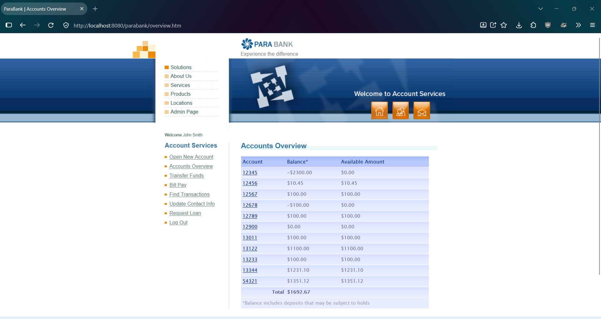
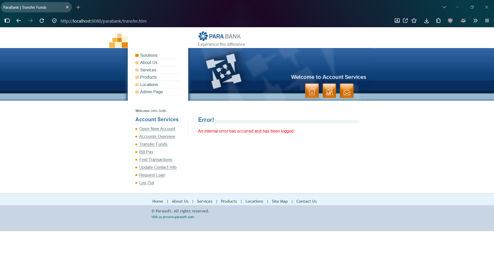

# PBQ-6: Transfer Funds shows a generic internal error for a non-numeric or empty amount instead of a validation message

| Field | Value |
|---|---|
| Status | Open |
| Severity | Minor |
| Priority | Medium |
| Feature | F-05 Transfer Funds |
| Related test cases | TC-F05-08, TC-F05-09 |
| Related risk | R-04 |
| Environment | ParaBank (parasoft/parabank, master) run locally on Windows 11, Java 21, default Admin settings, baseline data, user john |
| Reproduced | 2 of 2 attempts for each input |

## Steps to reproduce (non-numeric amount)
1. Restart ParaBank to the baseline and log in as john / demo.
2. Open Accounts Overview. Note account 13122 = 1100.00, account 12900 = 0.00, total = 1692.67.
3. Click Transfer Funds.
4. Type abc as the amount, select From account 13122 and To account 12900.
5. Click Transfer.
6. Open Accounts Overview.

## Steps to reproduce (empty amount)
Same as above, but leave the amount empty in step 4.

## Expected result
A clear validation message is shown (for example, that the amount must be a number), no balances change, and the form can be corrected and resubmitted (assumption: normal input validation; ParaBank has no requirements document).

## Actual result
- Non-numeric: the amount field accepts letters. After clicking Transfer, the page shows "Error! An internal error has occurred and has been logged."
- Empty: after clicking Transfer, the page shows the same "Error! An internal error has occurred and has been logged."
- In both cases, balances are unchanged (13122 = 1100.00, 12900 = 0.00, total = 1692.67), and Accounts Overview loads normally afterwards.

## Impact
The user gets no indication of what is wrong with the input. The same generic message appears on other pages for other invalid input (see Request Loan, not yet tested). Severity is Minor because no money moves and the rest of the site keeps working, unlike the failure with more than two decimals (PBQ-5).

## Evidence
Non-numeric amount, before:

Non-numeric amount, page after clicking Transfer:

Non-numeric amount, Accounts Overview afterwards:

Empty amount, before:

Empty amount, page after clicking Transfer:

Empty amount, Accounts Overview afterwards:

