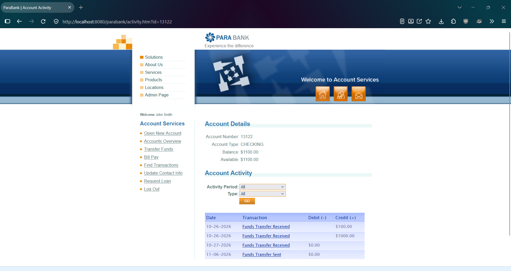
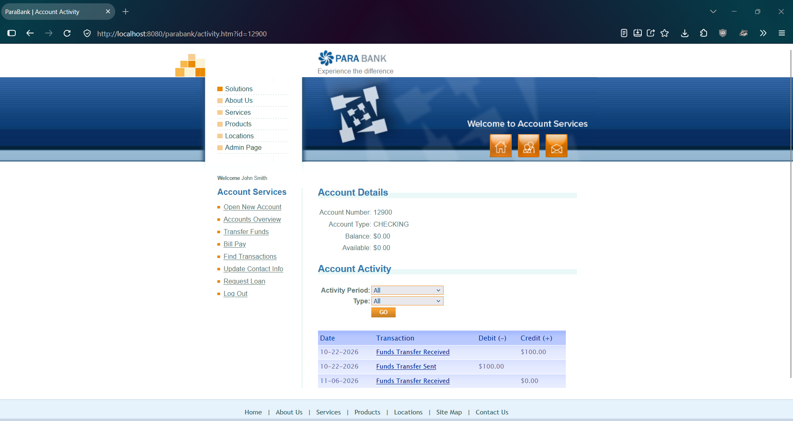
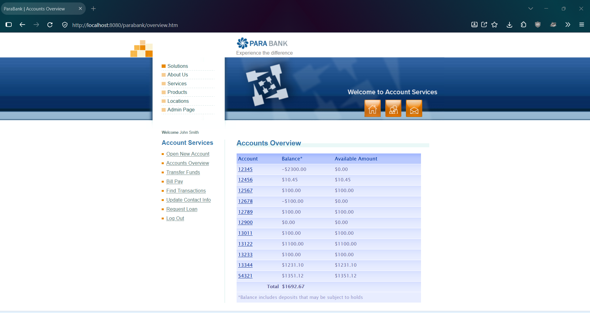
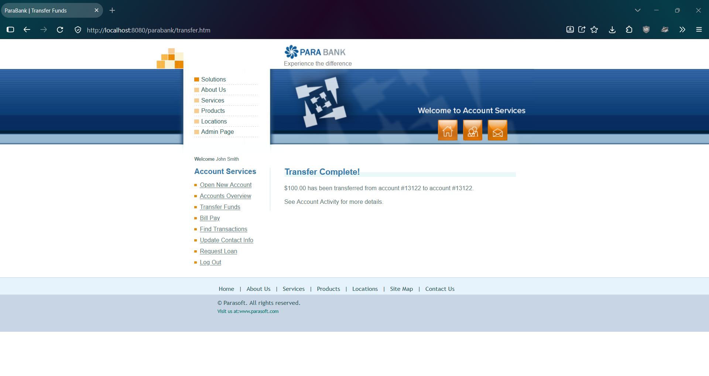
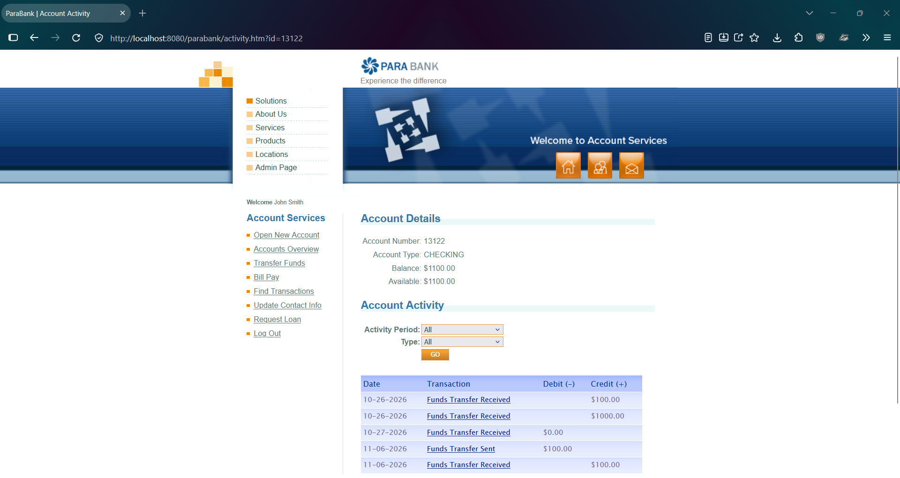

# PBQ-7: Transfer Funds accepts zero-amount and same-account transfers and records them in the account history

| Field | Value |
|---|---|
| Status | Open |
| Severity | Minor |
| Priority | Low |
| Feature | F-05 Transfer Funds |
| Related test cases | TC-F05-05, TC-F05-10 |
| Environment | ParaBank (parasoft/parabank, master) run locally on Windows 11, Java 21, default Admin settings, baseline data, user john |
| Reproduced | Acceptance: 2 of 2 attempts for each input. History entries: observed in 1 run for each input. |

## Steps to reproduce (zero amount)
1. Restart ParaBank to the baseline and log in as john / demo.
2. Open Accounts Overview. Note account 13122 = 1100.00, account 12900 = 0.00, total = 1692.67.
3. Click Transfer Funds.
4. Enter 0.00 as the amount, select From account 13122 and To account 12900.
5. Click Transfer.
6. Open Accounts Overview, then open the Account Activity of accounts 13122 and 12900.

## Steps to reproduce (same account)
1. Restart ParaBank to the baseline and log in as john / demo.
2. Click Transfer Funds.
3. Enter 100.00 as the amount and select account 13122 as both the From and the To account.
4. Click Transfer.
5. Open Accounts Overview, then open the Account Activity of account 13122.

## Expected result
Both transfers are rejected with a clear message, or at least no transaction is recorded (assumption: a transfer of nothing, or from an account to itself, has no meaning; ParaBank has no requirements document and the intended rule is unknown).

## Actual result
- **Zero amount:** the page shows "Transfer Complete! $0.00 has been transferred from account #13122 to account #12900." Balances are unchanged (13122 = 1100.00, 12900 = 0.00, total = 1692.67). Account 13122 shows a new "Funds Transfer Sent" debit of $0.00 and account 12900 shows a new "Funds Transfer Received" credit of $0.00.
- **Same account:** the page shows "Transfer Complete! $100.00 has been transferred from account #13122 to account #13122." Balances are unchanged (13122 = 1100.00, 12900 = 0.00, total = 1692.67). Account 13122 shows two new transactions: "Funds Transfer Sent" debit of $100.00 and "Funds Transfer Received" credit of $100.00.

## Impact
Meaningless transactions are added to the account history, which clutters the audit trail and can mislead a customer or an auditor. No money is lost, so severity is Minor.

## Evidence
Zero amount, before:

Zero amount, page after clicking Transfer:

Zero amount, Accounts Overview afterwards:

Zero amount, Account Activity for 13122:

Zero amount, Account Activity for 12900:

Same account, before:

Same account, page after clicking Transfer:

Same account, Accounts Overview afterwards:

Same account, Account Activity for 13122:

