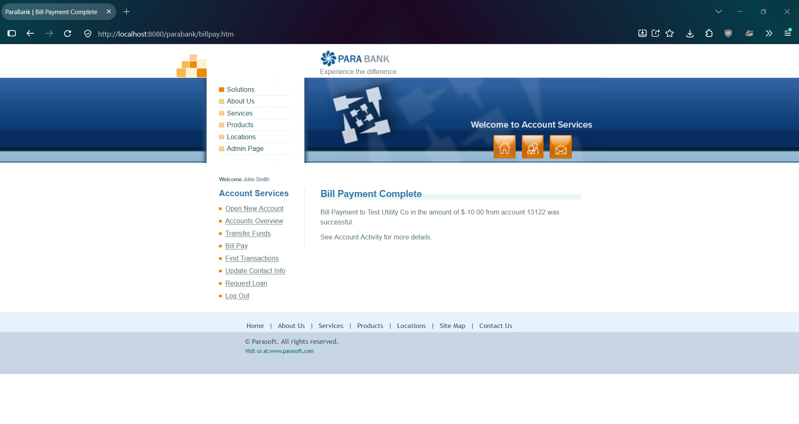
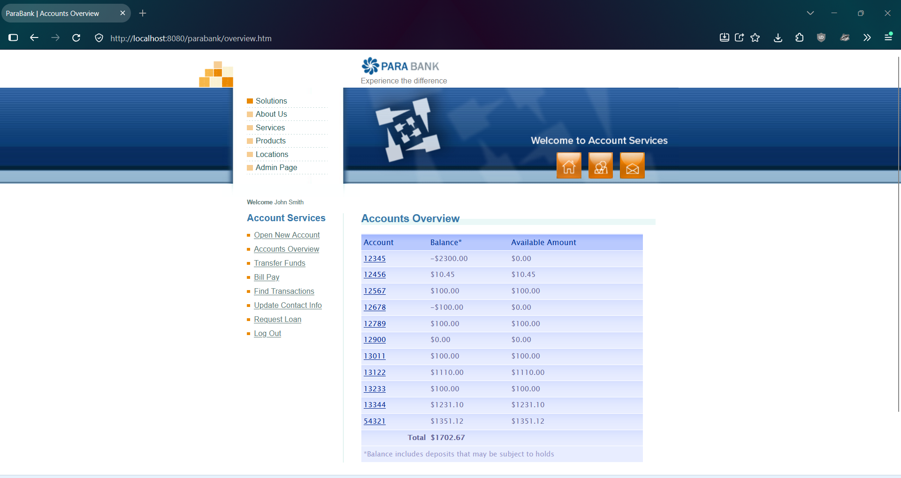

# PBQ-8: Bill Pay accepts a negative amount and adds money to the From account

| Field | Value |
|---|---|
| Status | Open |
| Severity | Critical |
| Priority | High |
| Feature | F-06 Bill Pay |
| Related test case | TC-F06-06 |
| Related lead and defect | EO-01, PBQ-3 (same missing amount validation in Transfer Funds) |
| Environment | ParaBank (parasoft/parabank, master) run locally on Windows 11, Java 21, default Admin settings, baseline data, user john |
| Reproduced | 2 of 2 attempts |

## Steps to reproduce
1. Restart ParaBank to the baseline and log in as john / demo.
2. Open Accounts Overview. Note account 13122 = 1100.00 and total = 1692.67.
3. Click Bill Pay.
4. Enter the payee details (Payee Name: Test Utility Co; Address: 1 Test St; City: Testville; State: CA; Zip Code: 90210; Phone #: 555-0100; Account # and Verify Account #: 888888).
5. Enter -10.00 as the amount and select From account 13122.
6. Submit the payment.
7. Open Accounts Overview.

## Expected result
The payment is rejected with a clear message and no balance changes (assumption: normal banking rule; ParaBank has no requirements document).

## Actual result
The payment is accepted. The page shows "Bill Payment to Test Utility Co in the amount of $-10.00 from account 13122 was successful." Account 13122 increases by 10.00 to 1110.00 and the Accounts Overview total increases from 1692.67 to 1702.67.

## Impact
A bill payment is meant to reduce the customer's funds. With a negative amount, the account balance and the total both increase without any matching deduction, so money is created. Unlike the negative transfer in PBQ-3, where the total stays the same, this changes the total.

## Evidence
Before the payment:

Page after submitting the payment:

After the payment:

