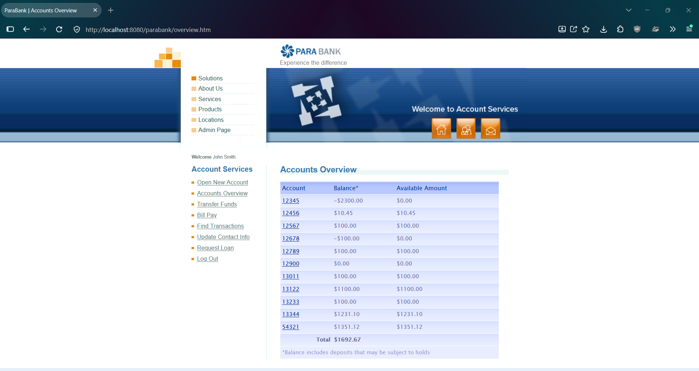
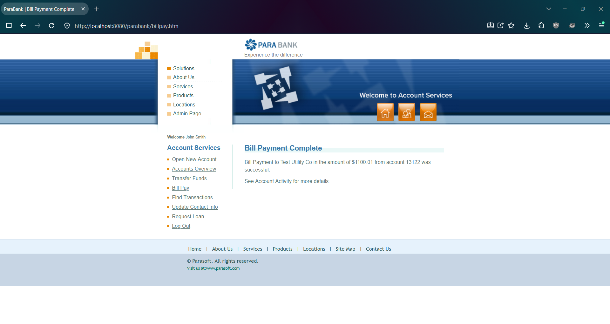

# PBQ-9: Bill Pay accepts a payment greater than the available balance and overdraws the From account

| Field | Value |
|---|---|
| Status | Open |
| Severity | Major |
| Priority | Medium |
| Feature | F-06 Bill Pay |
| Related test case | TC-F06-04 |
| Related lead and defect | EO-02, PBQ-4 (same missing balance check in Transfer Funds) |
| Environment | ParaBank (parasoft/parabank, master) run locally on Windows 11, Java 21, default Admin settings, baseline data, user john |
| Reproduced | 2 of 2 attempts |

## Steps to reproduce
1. Restart ParaBank to the baseline and log in as john / demo.
2. Open Accounts Overview. Note account 13122 = 1100.00 and total = 1692.67.
3. Click Bill Pay.
4. Enter the payee details (Payee Name: Test Utility Co; Address: 1 Test St; City: Testville; State: CA; Zip Code: 90210; Phone #: 555-0100; Account # and Verify Account #: 888888).
5. Enter 1100.01 as the amount and select From account 13122.
6. Submit the payment.
7. Open Accounts Overview.

## Expected result
The payment is rejected with a clear insufficient-funds message and no balance changes (assumption: normal banking rule; ParaBank has no requirements document, and the intended overdraft rule is unknown).

## Actual result
The payment is accepted. The page shows "Bill Payment to Test Utility Co in the amount of $1100.01 from account 13122 was successful." Account 13122 = -0.01 (available amount 0.00) and the Accounts Overview total is 592.66.

## Impact
A payment can exceed the available balance, so accounts can be overdrawn by bill payments, and money goes out to an outside payee that the customer does not have. Severity is Major and not Critical because it is not confirmed whether overdrafts are intended (the seeded data contains accounts 12345 and 12678 with negative balances). Request Loan does reject a down payment above the account balance, so the application is inconsistent.

## Evidence
Before the payment:

Page after submitting the payment:

After the payment:

